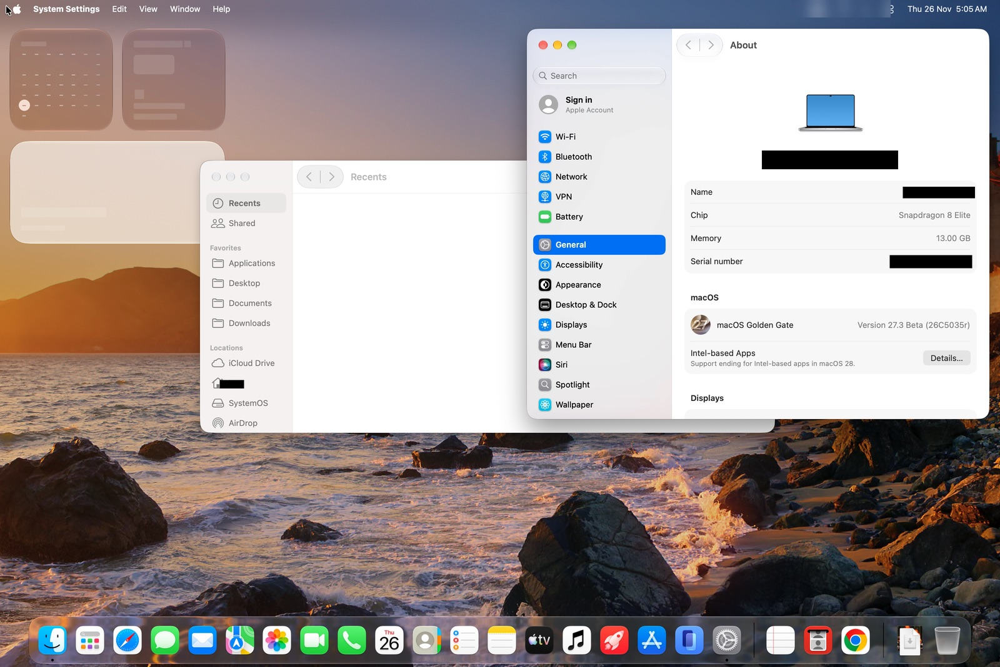
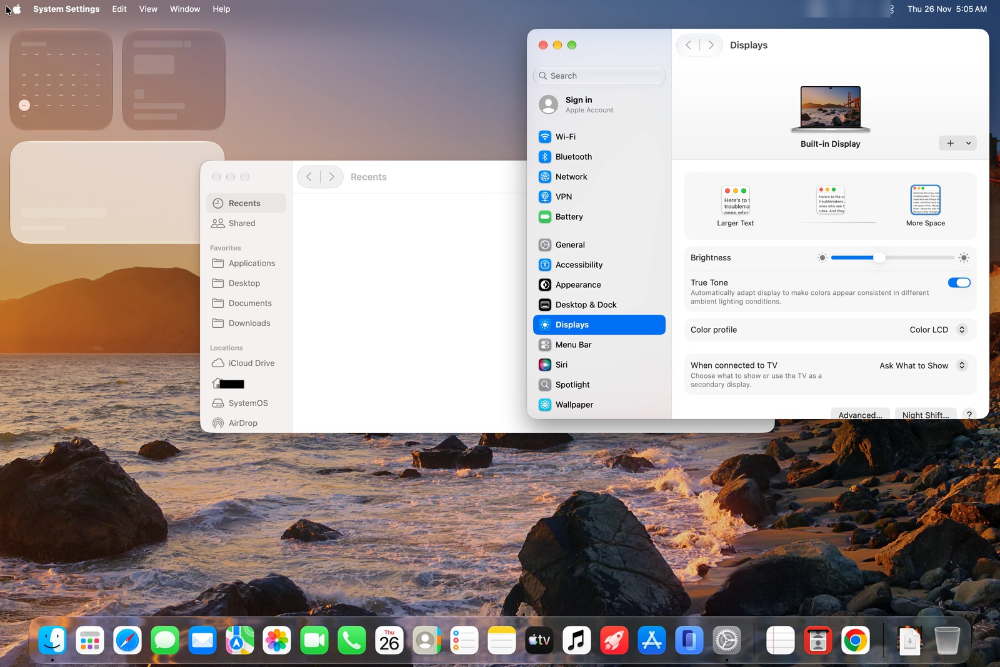
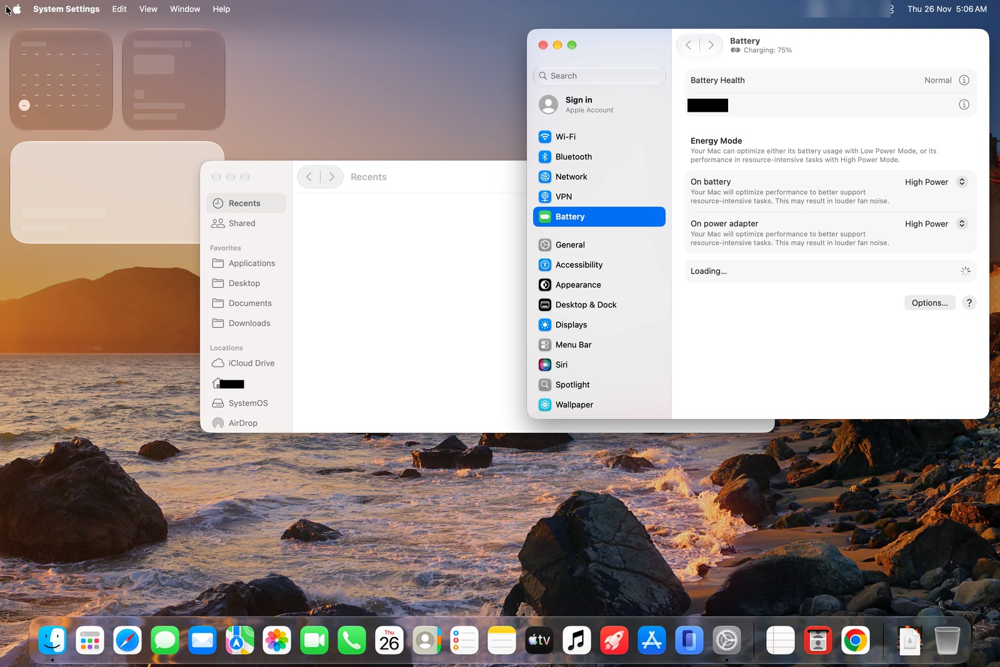
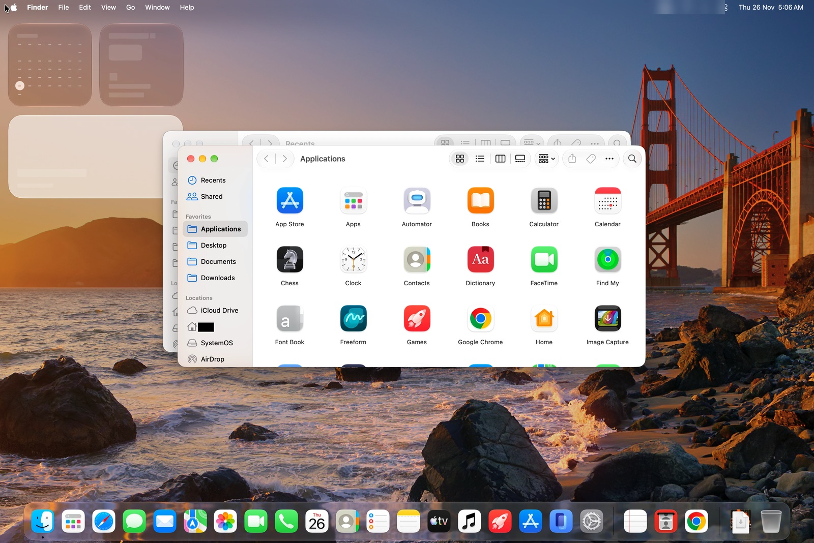
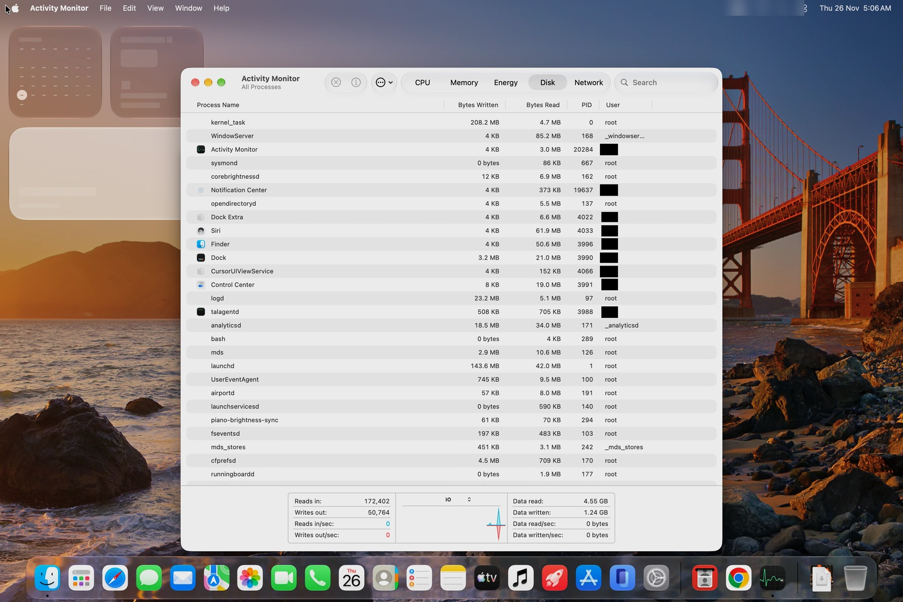
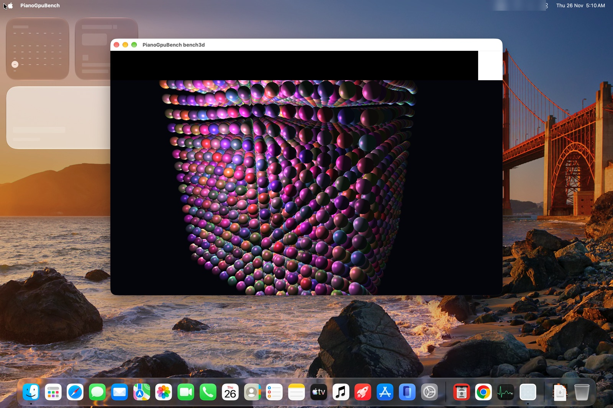
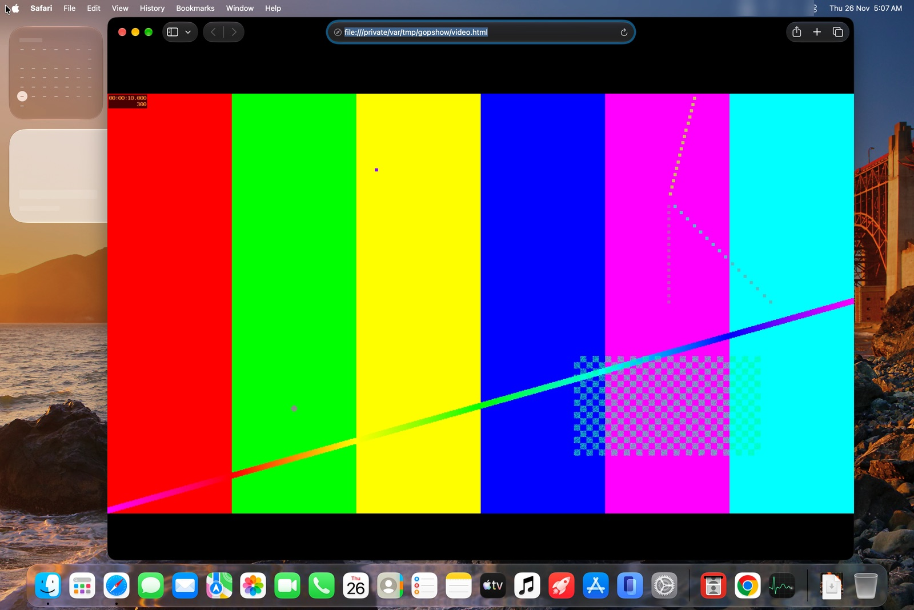

English | [简体中文](STATUS.zh-CN.md)

# Support status (2026-11-26)

One row per feature. Every status comes from a run on the tablet; host tests, analyses and "built, not run" work do not count.

- **Works (installed)**: verified on the system installed on the tablet's disk, booted from disk.
- **RAM only**: verified on a `fastboot boot` RAM image, not yet on the installed system.
- **Partial**: works, with the gaps named in the note.
- **Not yet**: not working, or never run on the tablet.

The installed daily build is **v13.1y12m** (installed 2026-11-26, an ESP-only update on v13.1y12l; its install round: 67 PASS,
3 FAIL, all checker misses whose evidence shows the feature working; its RAM qualification: 429 PASS, its FAILs test or harness
issues or switches that are off on the daily line). "Verified" names the build and date of
the newest run that showed the result. Daily results: [results-2026-11-26.md](results-2026-11-26.md) and the earlier
`results-*.md` pages.

✅ fully supported · 🟡 partial / in progress · ❌ not supported

| Feature | Status | Verified (build, date) | Note |
| --- | --- | --- | --- |
| Boot from disk, persistent install | ✅ Works (installed) | v13.1y12m, 2026-11-26 | Disk boot, exact ESP profile, the owner's Data store resumed, boot guard healthy, no panic. v13.1y12m was an ESP-only update on v13.1y12l: install round 67 PASS; its 3 FAILs are checker misses (a console line cut short, a too-broad pattern, a log read in the wrong window) whose evidence shows the feature working. Installs write only changed parts, after backups, with read-back checks and a rollback to the previous build. |
| Display | ✅ Works (installed), 60 Hz | v13.1y12m, 2026-11-26 | Frames reach the panel through PianoDpu flips on the boot framebuffer's pipes; the CPU still does per-frame work (a cache clean, split over 4 threads). No underrun, revert or SMMU fault over the session. Native screenshots on the device, taken from the display driver, are on in the daily line. Native panel sleep, Night Shift and refresh switching are built but off by default (in qualification). |
| 120 Hz | 🟡 RAM only | RAM gpu-hz120-2, 2026-11-21 | 120 Hz is exposed and kept across display off/on; 73-78 new frames/s are presented. The daily profile stays at 60 Hz. |
| Touch screen (native) | ✅ Works (installed) | v13.1y12l, 2026-11-26; gestures on RAM touch-native3, 2026-11-23 | A native built-in Touch Screen bound to the display: tap, long press (right click), pan and scroll in scroll views, pinch, rotate, smart magnify, palm rejection, 90 degree axes (44/0 on RAM). Installed: published from boot and acquired by the system. Long use by hand on the native path is pending. |
| Keyboard cover and trackpad | ✅ Works (installed) | owner hands-on, v12, 2026-11-19; v13.1y12l, 2026-11-26 | Typing and the trackpad work; the cover is known to the login window. |
| Wi-Fi | 🟡 Works (installed), partial | v13.1y12l, 2026-11-26; v13.1x, 2026-11-21 | Joins at boot (WPA2, DHCP, DNS); radio off/on from the switch rejoins; a forced link loss rejoins within seconds; country code set. Pending: joining by clicking a network row by hand, auto-rejoin after a hotspot goes away and comes back, and a multi-access-point office network. |
| Bluetooth | ❌ Not yet (in progress) | owner session on an installed v13.1 build, 2026-11-20; v13.1y12m, 2026-11-26 | Discovery works; a Bluetooth LE connection timed out (HCI 0x08) before the link was ready, so keyboards and mice did not pair. The LE event-mask fix is now on the daily line (v13.1y12m: the controller is ready and the mask is set at the Bluetooth daemon's start); pairing a keyboard and a mouse still needs a hands-on test. The radio coexistence with Wi-Fi (the shared antenna) is under analysis. Bluetooth audio not started. |
| Speakers | ✅ Works (installed) | v13.1u, 2026-11-21 (audible tone) | Playback, volume and mute; speaker protection at gain 243 and the stock Dolby "Movie" processing run on the DSP. Since 2026-11-23, installs are silent by request, so later installs check the output device without a tone. |
| Microphone | 🟡 Partial | v13.1y12l, 2026-11-26; noise reduction on RAM mic-ns4b, 2026-11-23 | The raw "Mic" device (the default input) and a "Mic (noise reduced)" device (RNNoise) are in the audio system on the installed boot. The recording-during-playback stutter was fixed on the installed system (2026-11-21). An app recording (QuickTime) played back by hand is pending. |
| Cameras: Photo Booth | ✅ Works (installed) | v13.1y12l, 2026-11-26 | Live front preview with no prompt; the effects grid opens. |
| Cameras: QuickTime | 🟡 Partial | v13.1y12l, 2026-11-26 | 10 s H.264 movies from the front and rear cameras record (AVFoundation, the QuickTime High preset). A New Movie Recording saved and played back by hand is pending. Encoding is in software. |
| Cameras: FaceTime | 🟡 Not yet verified | permissions pre-granted, v13.1y12l, 2026-11-26 | Both cameras are listed and FaceTime has Camera and Microphone access; a FaceTime self-view has not been checked. |
| Charging: 5 V | ✅ Works (installed) | v13.1y12d, 2026-11-24 | Up to 3 A from a 3 A source (input limit 3000 mA; on a computer port the input settles near 1.8 A when the bus sags to about 4.72 V); net battery charge current positive. |
| Charging: PD 9 V (buck) | ✅ Works (installed) | v13.1y12d, 2026-11-24 | On by default. Fixed 9 V PD on the stock charger: 9 V / 1.6 A (about 14 W, the current the charger firmware requests, as on Ubuntu). PPS 9 V (up to 2.5 A) is built but not run. |
| Charging: 80 % hold | ✅ Works | RAM chg-buck6, 2026-11-17; in every installed profile since | Stops at 80 %, resumes at 75 %. |
| Charging: charge pump / MiPPS | ❌ Not yet | first attended try, 2026-11-24 | Off by default. The first attempt stayed at a 100 mA input limit (an unmapped vendor power object); fixed in the build, the next attended test is pending. |
| Battery percentage | ✅ Works (installed) | v13.1y12k, 2026-11-25 | Percentage, charging state and the gauge read correctly. Cycle count, health and time-to-full fields are not filled yet. |
| Sleep and wake | 🟡 Partial | v13.1y12m, 2026-11-26; RAM v13.1y12m qualification, 2026-11-26 | Suspend-to-idle with a timer wake works; Wi-Fi and the USB link recover; the lock screen appears. The cover and power-key policy is armed on the installed system: closing the cover on the charger locks without sleeping (charging goes on), the power key sleeps and wakes (both shown on the RAM qualification). Closing the cover on battery is still an attended check. |
| Brightness: manual | 🟡 Partial | keys on installed v12, 2026-11-19; slider path on v13.1i | Brightness keys work. The slider path through the system's brightness control works; a hand drag in Control Center is pending. |
| Brightness: automatic | ✅ Works (installed) | v13.1y12l, 2026-11-26 | The light sensor drives automatic brightness; manual moves do not end automatic mode. A real light-change span is pending. |
| GPU: Metal (Adreno 830) | ✅ Works (installed) | v13.1y12l, 2026-11-26 | Our Metal plug-in runs WindowServer, the desktop and apps; ImageIO, Core Image on Metal, MetalKit texture loading and Quick Look thumbnails pass: 30 of 30 graded paths, including the 4032-pixel Core Image and HEIC texture paths that ran out of memory before; Preview opens a 4032-pixel photo. |
| GPU: paged memory | ✅ Works (installed) | v13.1y12l, 2026-11-26 | 4 KiB paged GPU memory (cap 7168 MiB, no fixed pool), no refusals, no page faults; hang recovery by replay on by default. |
| GPU: Android-level frequency curve | ✅ Works (installed) | v13.1y12l, 2026-11-26 | The Android 14-level table up to 1100 MHz with its skin and thermal steps and a KGSL-style governor; the Android CPU table. Sustained 3D bench about 50-54 fps at 734 MHz (RAM, 2026-11-23). |
| GPU: 4 GiB windows | ✅ Works (installed) | v13.1y12l, 2026-11-26 | 64 client windows of 4 GiB in a 256 GiB aperture, 1 GiB per object, no GPU open refused. Fixes the Core Image 4032-pixel out-of-memory paths (Metal image check 30/30). |
| Safari: WebGL 2 and WebGPU | ✅ Works (installed) | v13.1y12m, 2026-11-26 | WebGL 2 on, WebGPU adapter "adreno" (a WebGPU page at about 52 fps with a correct readback); Safari's GPU process opens the accelerator. |
| Safari: hardware video decode | ✅ Works (installed) | v13.1y12m, 2026-11-26; v13.1y12i, 2026-11-25 | H.264 up to 1920x1088 decodes on the Iris video core: 1080p 600 frames, 0 dropped. |
| Safari: HEVC and 4K | ✅ Works (installed), software | v13.1y12j, 2026-11-25; plays again on v13.1y12m | HEVC 2160p 600/0 at 29.9 fps and H.264 2160p 591/5, in Apple's software decoders (by design). VP9 and AV1 are not supported. |
| Chrome: GPU acceleration | ✅ Works (installed) | v13.1y12m, 2026-11-26; videos on v13.1y12l | With Chrome's GPU sandbox on and no flags: WebGL through ANGLE on Metal (Adreno 830, about 38 fps in the WebGL test on v13.1y12m), GPU compositing, canvas 2D 56 fps, scrolling 60 fps with no frame over 34 ms. Every test video played with 0-1 dropped frames: H.264 and HEVC at 1080p and 2160p, VP9 and AV1 at 1080p (HEVC through VideoToolbox, the others in Chrome's software decoders). No crash report. Chrome is not used on RAM boots (it can exhaust the RAM-backed Data disk). |
| Chrome: WebGPU | ✅ Works (installed) | v13.1y12m, 2026-11-26 | Without flags: adapter Qualcomm "adreno-8xx", WebGPU contexts 6 of 6, compute results correct, a WebGPU frame drawn and read back. Kernel patch 0075 gives processes a 47-bit user address space, so Chrome's V8 sandbox reserves its full region (1152 GB). Open detail: one of Chrome's 17 processes reports a non-secure V8 sandbox mode (under investigation). |
| Video playback (QuickTime) | ✅ Works (installed) | v13.1x, 2026-11-21 | AVC High and HEVC Main10 decoded in hardware; about 100 s each with 0 transient or dark frames on the webcam. |
| Energy modes | 🟡 Partial | v13.1y12l, 2026-11-26 | Low Power, Automatic and High Power (the daily setting) set with `pmset` reach the power and thermal policy. The picker in System Settings is not verified by hand. |
| Login window idle CPU | ✅ Works (installed) | v13.1y12l, 2026-11-26 | Fixed: an audio daemon looped at the login window (about 1.3 cores); it is now held until the login. |
| App launches | ✅ Works (installed) | v13.1y12l, 2026-11-26 | Calculator, TextEdit and Notes open their first window in under 2.5 s. |
| USB debug (console, root shell, ssh) | ✅ Works (installed) | v13.1y12l, 2026-11-26 | USB-C debug console with a monitor that returns to the bootloader, root shell and ssh over the cable; no endpoint wedge over the boot. |
| OS switcher (Android / macOS) | 🟡 RAM only, read-only | RAM v13.1y12e, 2026-11-24 | The boot-flag sysctls read the flag; writes are refused by design. A full switch has not been run. |
| USB host / OTG | ❌ Not yet | RAM usb-a2d, 2026-11-18 (empty port) | Host mode starts on an empty port; VBUS supply and a real device are not done. |
| External display (USB-C DP) | ❌ Not yet | none | Design only. |
| Auto-rotate and other sensors | ❌ Not yet | RAM, 2026-11-19 (accelerometer sample) | The light sensor works; auto-rotate is off in the daily profile and in analysis. |
| Hardware video encode | ❌ Not yet | camera recordings, 2026-11-25 | Recordings use the software encoder. |
| IR blaster, stylus, torch | ❌ Not yet | none | Drivers built or designed, not run. |
| Memory (16 GB) | 🟡 Partial | v13.1y12l, 2026-11-26 | The installed system uses a 13 GiB window (13310 MiB; was 8 GiB). At idle: 47 % free, no compression, no swap, no memory pressure. In progress: the GPU memory tier and the driver pools. |
| Internal storage (UFS) | 🟡 Partial | v13.1y12l, 2026-11-26 (first measurement) | On the Data volume, against Android on the same unit: 4K random read at queue depth 1 equals Android (15580 vs 14967 IOPS), but reads do not scale with queue depth (8 in flight: 15696 vs 88663); writes are 0.18-0.24x Android (sequential 519 vs 2137 MB/s, 4K random 6494 vs 36693 IOPS); a reader drops from 14490 to 1300 IOPS while a writer runs. WriteBooster is already on from the boot firmware. Fixes are in progress. |
| Fingerprint, NPU | ❌ Deferred | none | No Secure Enclave (no Touch ID); no Core ML backend on this SoC. |

## Known gaps

- Bluetooth pairing (the LE event-mask fix is on the daily line; a hands-on keyboard and mouse test is pending; radio coexistence
  under analysis) and Bluetooth audio.
- Closing the cover on battery (attended check); the Energy Mode picker; the brightness slider by hand.
- Chrome: one of 17 processes reports a non-secure V8 sandbox mode (under investigation); Chrome on RAM boots.
- Charge pump / MiPPS fast charging; PPS 9 V.
- 120 Hz in daily use; native panel sleep, Night Shift and refresh switching (built, off by default, in qualification); the GPU
  memory tier and driver pools.
- Disk: no read scaling with queue depth, writes 0.18-0.24x Android, reads stall behind writes (fixes in progress).
- USB host devices, external display, auto-rotate (in analysis), hardware video encode, VP9/AV1 in Safari.
- The install guide for other units (in progress).
- Hand checks pending on the installed system: microphone recording in an app, QuickTime recording by hand, FaceTime self-view,
  joining a Wi-Fi network from the menu, Wi-Fi auto-rejoin after the network returns.

## Showcase

Screenshots and short clips of the features above, taken on the tablet itself (native screen captures). Webcam footage is used
only where the physical view matters (rotation, touch). Every file is reviewed frame by frame before it is published: network
names, account names, notifications, serials and personal content are blurred or cropped, and metadata is stripped. The sources
of each file are listed in [media/SOURCES.md](media/SOURCES.md).

| Scene | Media | Status |
| --- | --- | --- |
| About This Mac (Snapdragon 8 Elite, 13 GB visible, macOS 27.3) |  | ✅ native capture, v13.1y12m |
| Displays settings (built-in display, brightness, True Tone, Night Shift) |  | ✅ native capture, v13.1y12m |
| Battery settings (charging, Energy Mode High Power) |  | ✅ native capture, v13.1y12m |
| Desktop with Finder (Applications) |  | ✅ native capture, v13.1y12m |
| Activity Monitor (disk view) |  | ✅ native capture, v13.1y12m |
| Metal 3D demo (GPU benchmark scene) |  | ✅ native capture, v13.1y12m |
| Safari playing a test video (hardware decode) |  | ✅ native capture, v13.1y12m |
| Photo Booth live camera view | coming | native capture scheduled |
| Wi-Fi network list | coming | native capture scheduled (network names will be blurred) |
| Touch gestures (tap, pinch, rotate, scroll) | coming | the existing webcam recordings are out of focus; a new recording is needed |
| Rotation to portrait | coming | the existing webcam recordings are out of focus; a new recording is needed |
| Chrome with GPU acceleration | coming | native capture scheduled (Chrome's GPU path works since v13.1y12l) |
