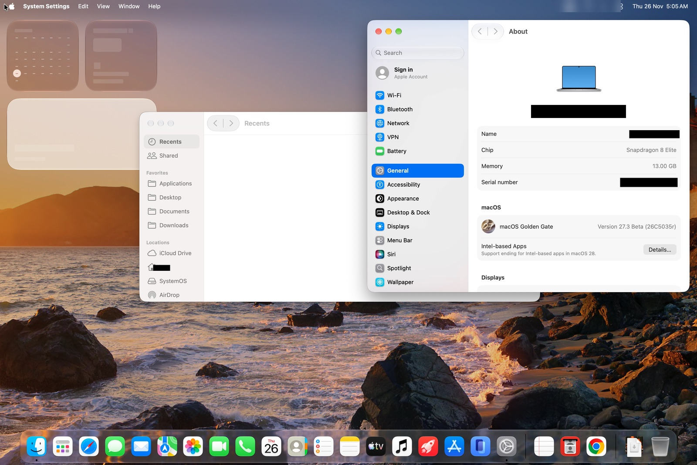
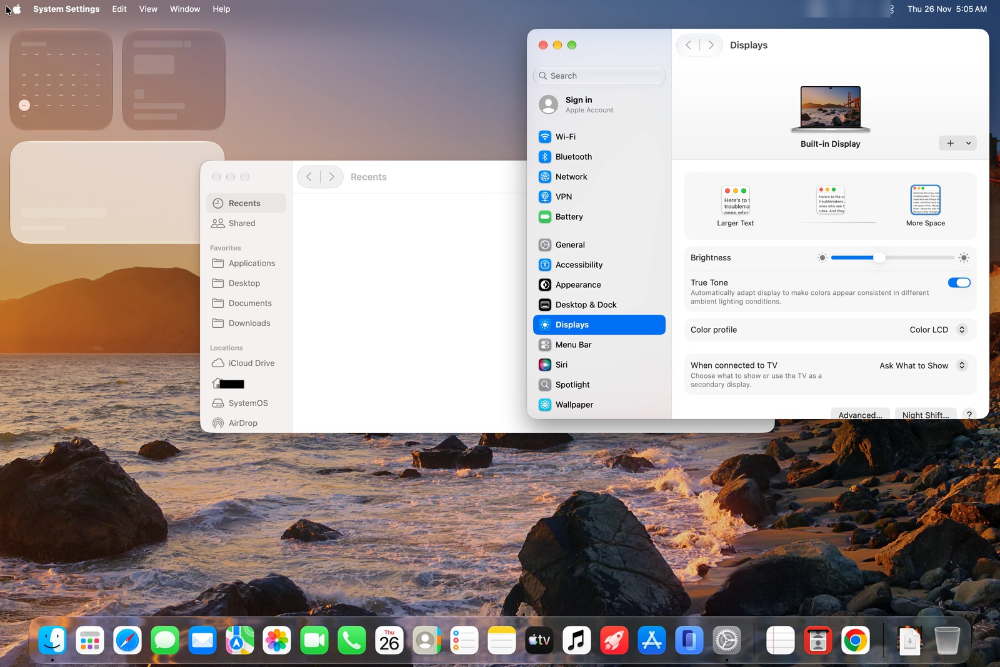
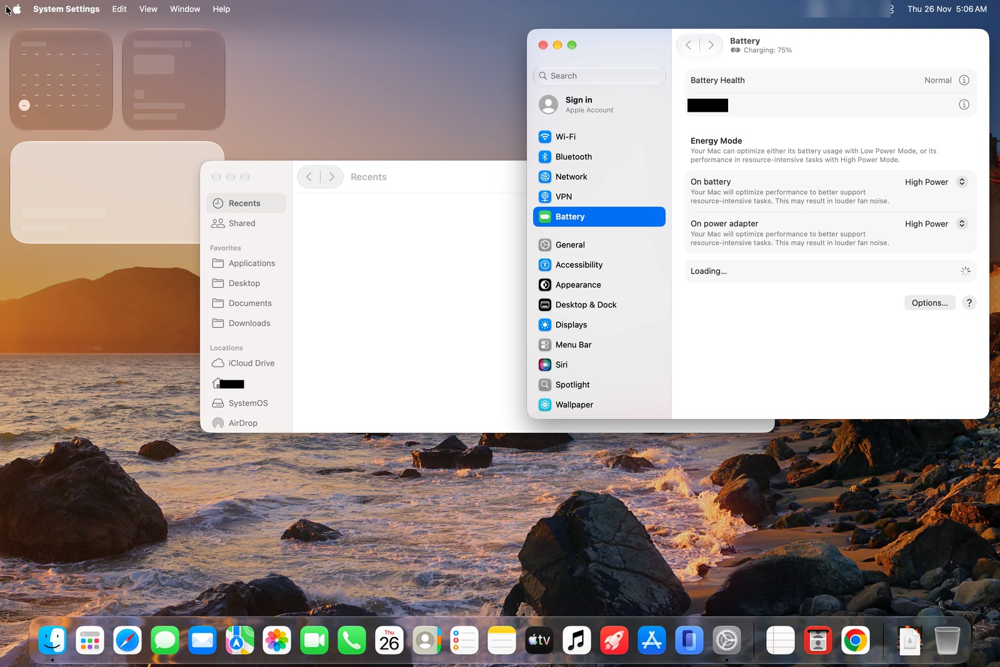
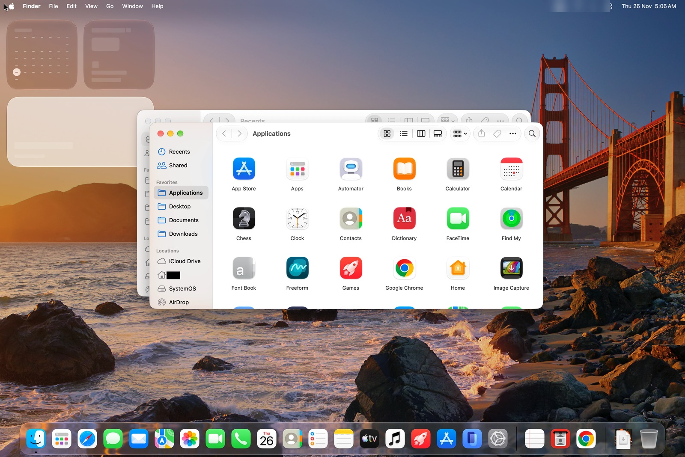
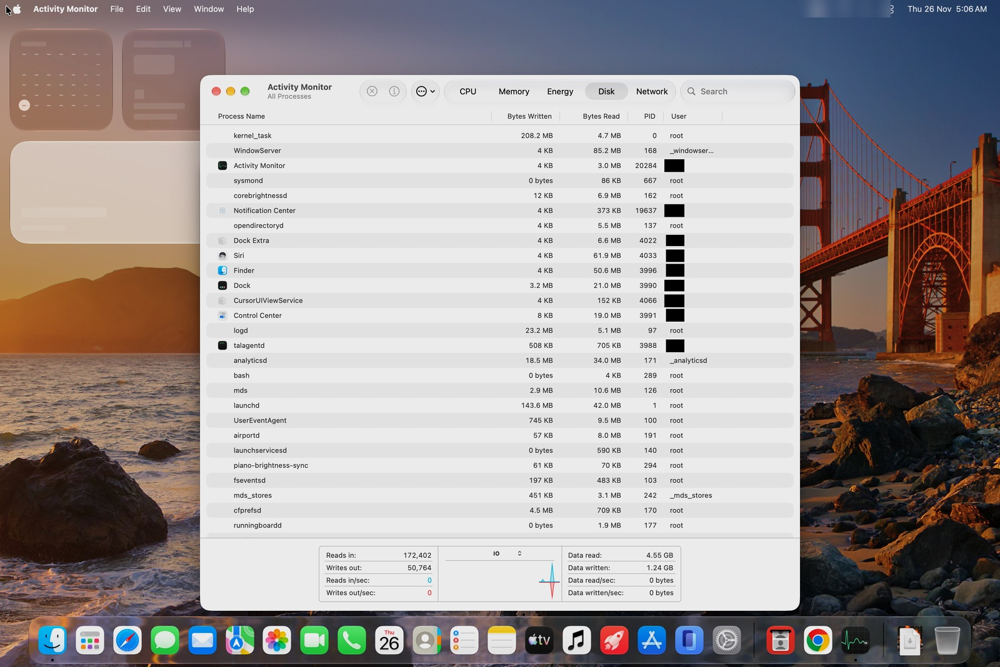
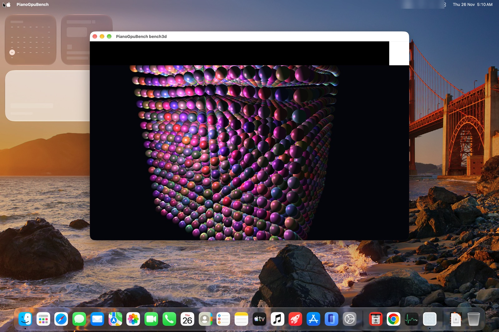
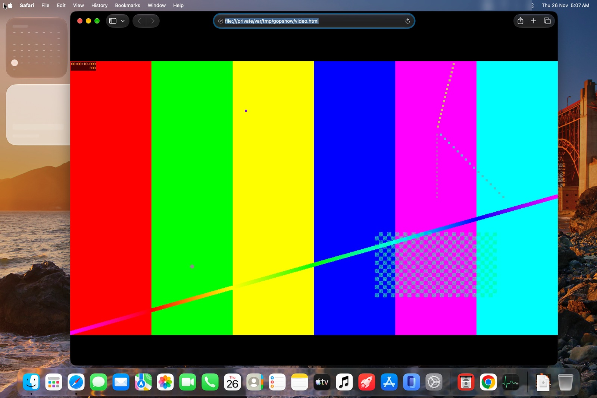

[English](STATUS.md) | 简体中文

# 支持状态（2026-11-26）

每项功能一行。所有状态都来自平板上的实际运行；主机测试、分析以及“已构建但未运行”的工作都不算。

- **可用（已安装）**：在安装到平板磁盘、从磁盘启动的系统上验证过。
- **仅 RAM**：在 `fastboot boot` 的 RAM 镜像上验证过，尚未在已安装系统上验证。
- **部分可用**：可用，但有备注中列出的缺口。
- **尚未支持**：不能用，或从未在平板上运行过。

当前已安装的日常版本是 **v13.1y12m**（2026-11-26 安装，在 v13.1y12l 上只更新 ESP；安装轮次 67 项通过、3 项失败，都是检查器漏判，证据显示功能本身正常；
其 RAM 资格测试 429 项通过，失败项是测试或测试工具问题，或日常版本中关闭的开关）。“验证”一栏写的是显示该结果的最新一次运行所用的版本和日期。
每日结果：[results-2026-11-26.md](results-2026-11-26.md) 及更早的 `results-*.md` 页面（英文）。

✅ 完整支持 · 🟡 部分支持 / 进行中 · ❌ 尚不支持

| 功能 | 状态 | 验证（版本，日期） | 说明 |
| --- | --- | --- | --- |
| 从磁盘启动、持久安装 | ✅ 可用（已安装） | v13.1y12m，2026-11-26 | 从磁盘启动，ESP 配置完全一致，机主的 Data 存储正常恢复，启动保护正常，无 panic。v13.1y12m 是在 v13.1y12l 上只更新 ESP 的版本：安装轮次 67 项通过；其 3 项失败都是检查器漏判（控制台行被截断、匹配模式过宽、在错误的时间窗口读日志），证据显示功能本身正常。安装只写改动部分，先备份，写后回读校验，并可回滚到上一个版本。 |
| 显示 | ✅ 可用（已安装），60 Hz | v13.1y12m，2026-11-26 | 画面通过 PianoDpu 在启动帧缓冲的图层管线上翻页送到面板；CPU 仍要做逐帧工作（缓存清理，分 4 个线程）。整个会话中没有欠载、回退或 SMMU 错误。由显示驱动在设备上直接截取的原生截图已在日常版本中开启。原生面板休眠、夜览和刷新率切换已构建，但默认关闭（资格测试中）。 |
| 120 Hz | 🟡 仅 RAM | RAM gpu-hz120-2，2026-11-21 | 系统能提供 120 Hz 模式，且在显示关闭再打开后保持；实际每秒呈现 73-78 个新帧。日常配置仍为 60 Hz。 |
| 触摸屏（原生） | ✅ 可用（已安装） | v13.1y12l，2026-11-26；手势在 RAM touch-native3，2026-11-23 | 绑定到显示器的原生内置触摸屏：点按、长按（右键）、在滚动视图中拖动与滚动、双指缩放、旋转、智能缩放、防误触、90 度坐标（RAM 上 44 项通过 / 0 项失败）。已安装系统：开机即发布并被系统接管。原生路径的长期手动使用仍待验证。 |
| 键盘保护套与触控板 | ✅ 可用（已安装） | 机主实测，v12，2026-11-19；v13.1y12l，2026-11-26 | 打字和触控板可用；登录窗口能识别保护套键盘。 |
| Wi-Fi | 🟡 可用（已安装），部分 | v13.1y12l，2026-11-26；v13.1x，2026-11-21 | 开机自动连接（WPA2、DHCP、DNS）；开关关闭再打开后重新连接；强制断线后几秒内重连；国家码已设置。待验证：手动点击网络列表中的某一行加入、热点消失又恢复后的自动重连、多接入点的办公室网络。 |
| 蓝牙 | ❌ 尚未支持（进行中） | 机主在已安装的 v13.1 版本上测试，2026-11-20；v13.1y12m，2026-11-26 | 能发现设备；低功耗蓝牙连接曾在链路就绪前超时（HCI 0x08），因此键盘和鼠标无法配对。低功耗蓝牙事件掩码的修复现已进入日常版本（v13.1y12m：控制器就绪，蓝牙守护进程启动时设置了掩码）；键盘和鼠标配对仍需实机测试。与 Wi-Fi 的射频共存（共享天线）正在分析。蓝牙音频尚未开始。 |
| 扬声器 | ✅ 可用（已安装） | v13.1u，2026-11-21（有声测试音） | 播放、音量和静音；扬声器保护（增益 243）和原厂杜比 “Movie” 音效在 DSP 上运行。自 2026-11-23 起应要求静音安装，之后的安装只检查输出设备而不播放测试音。 |
| 麦克风 | 🟡 部分可用 | v13.1y12l，2026-11-26；降噪在 RAM mic-ns4b，2026-11-23 | 已安装系统的音频系统中有原始 “Mic” 设备（默认输入）和 “Mic (noise reduced)” 设备（RNNoise）。边播放边录音的卡顿已在已安装系统上修复（2026-11-21）。用应用（QuickTime）录音并手动回放仍待验证。 |
| 摄像头：Photo Booth | ✅ 可用（已安装） | v13.1y12l，2026-11-26 | 前置摄像头实时预览，无授权弹窗；特效网格可以打开。 |
| 摄像头：QuickTime | 🟡 部分可用 | v13.1y12l，2026-11-26 | 前置和后置摄像头都能录 10 秒 H.264 视频（AVFoundation，QuickTime 高质量预设）。手动“新建影片录制”并保存回放仍待验证。编码为软件编码。 |
| 摄像头：FaceTime | 🟡 尚未验证 | 权限已预先授予，v13.1y12l，2026-11-26 | 两个摄像头都已列出，FaceTime 已有摄像头和麦克风权限；尚未检查 FaceTime 自拍预览。 |
| 充电：5 V | ✅ 可用（已安装） | v13.1y12d，2026-11-24 | 3 A 电源下最高 3 A（输入限流 3000 mA；在电脑接口上，总线电压降到约 4.72 V 时输入稳定在约 1.8 A）；电池净充电电流为正。 |
| 充电：PD 9 V（降压） | ✅ 可用（已安装） | v13.1y12d，2026-11-24 | 默认开启。原装充电器上的固定 9 V PD：9 V / 1.6 A（约 14 W，即充电器固件请求的电流，与 Ubuntu 相同）。PPS 9 V（最高 2.5 A）已构建但未运行。 |
| 充电：80 % 上限 | ✅ 可用 | RAM chg-buck6，2026-11-17；此后每个已安装配置都包含 | 充到 80 % 停止，降到 75 % 恢复。 |
| 充电：电荷泵 / MiPPS | ❌ 尚未支持 | 首次有人值守尝试，2026-11-24 | 默认关闭。首次尝试时输入限流停在 100 mA（一个未映射的厂商电源对象）；已在版本中修复，下一次有人值守测试待进行。 |
| 电池电量百分比 | ✅ 可用（已安装） | v13.1y12k，2026-11-25 | 百分比、充电状态和电量计读数正确。循环次数、健康度和充满时间等字段尚未填写。 |
| 睡眠与唤醒 | 🟡 部分可用 | v13.1y12m，2026-11-26；RAM v13.1y12m 资格测试，2026-11-26 | 挂起到空闲并定时唤醒可用；Wi-Fi 和 USB 链路能恢复；锁屏界面正常出现。保护套和电源键策略已在已安装系统上启用：接着充电器时合上保护套只锁屏不睡眠（继续充电），按电源键睡眠和唤醒（两者都在 RAM 资格测试中验证）。用电池时合上保护套仍需现场检查。 |
| 亮度：手动 | 🟡 部分可用 | 按键在已安装 v12，2026-11-19；滑块路径在 v13.1i | 亮度键可用。通过系统亮度控制的滑块路径可用；在控制中心手动拖动仍待验证。 |
| 亮度：自动 | ✅ 可用（已安装） | v13.1y12l，2026-11-26 | 光线传感器驱动自动亮度；手动调整不会退出自动模式。真实光线变化范围的测试仍待进行。 |
| GPU：Metal（Adreno 830） | ✅ 可用（已安装） | v13.1y12l，2026-11-26 | 我们的 Metal 插件驱动 WindowServer、桌面和应用；ImageIO、基于 Metal 的 Core Image、MetalKit 纹理加载和快速查看缩略图全部通过：30 条评分路径 30 条通过，包括此前内存不足的 4032 像素 Core Image 和 HEIC 纹理路径；预览能打开 4032 像素的照片。 |
| GPU：分页内存 | ✅ 可用（已安装） | v13.1y12l，2026-11-26 | 4 KiB 分页 GPU 内存（上限 7168 MiB，无固定池），无拒绝、无缺页错误；默认开启重放式挂起恢复。 |
| GPU：Android 级频率曲线 | ✅ 可用（已安装） | v13.1y12l，2026-11-26 | Android 的 14 级频率表，最高 1100 MHz，含其表面温度和热控级别以及 KGSL 式调频器；Android 的 CPU 频率表。持续 3D 基准约 50-54 fps，734 MHz（RAM，2026-11-23）。 |
| GPU：4 GiB 窗口 | ✅ 可用（已安装） | v13.1y12l，2026-11-26 | 256 GiB 地址空间中 64 个 4 GiB 客户端窗口，单个对象 1 GiB，没有被拒绝的 GPU 打开请求。修复了 4032 像素 Core Image 内存不足的路径（Metal 图像检查 30/30）。 |
| Safari：WebGL 2 和 WebGPU | ✅ 可用（已安装） | v13.1y12m，2026-11-26 | WebGL 2 开启，WebGPU 适配器为 “adreno”（WebGPU 页面约 52 fps，回读正确）；Safari 的 GPU 进程能打开加速器。 |
| Safari：硬件视频解码 | ✅ 可用（已安装） | v13.1y12m，2026-11-26；v13.1y12i，2026-11-25 | 1920x1088 以内的 H.264 在 Iris 视频核心上解码：1080p 600 帧，丢帧 0。 |
| Safari：HEVC 和 4K | ✅ 可用（已安装），软件解码 | v13.1y12j，2026-11-25；v13.1y12m 上再次播放 | HEVC 2160p 600 帧 / 丢 0 帧，29.9 fps；H.264 2160p 解码 591 / 丢 5，均由 Apple 的软件解码器完成（按设计）。不支持 VP9 和 AV1。 |
| Chrome：GPU 加速 | ✅ 可用（已安装） | v13.1y12m，2026-11-26；视频在 v13.1y12l | 在开启 Chrome GPU 沙盒、不加任何启动参数的情况下：WebGL 经 ANGLE 运行在 Metal 上（Adreno 830，v13.1y12m 上 WebGL 测试约 38 fps）、GPU 合成、2D canvas 56 fps、滚动 60 fps 且没有超过 34 ms 的帧。所有测试视频都能播放，丢帧 0-1：1080p 和 2160p 的 H.264 与 HEVC，1080p 的 VP9 与 AV1（HEVC 经 VideoToolbox，其余由 Chrome 的软件解码器完成）。没有崩溃报告。RAM 启动时不使用 Chrome（它可能耗尽基于内存的 Data 盘）。 |
| Chrome：WebGPU | ✅ 可用（已安装） | v13.1y12m，2026-11-26 | 无需任何启动参数：适配器为 Qualcomm “adreno-8xx”，WebGPU 上下文 6/6，计算结果正确，WebGPU 画面绘制并回读成功。内核补丁 0075 为进程提供 47 位用户地址空间，使 Chrome 的 V8 沙盒能预留完整区域（1152 GB）。未决细节：Chrome 的 17 个进程中有 1 个报告非安全的 V8 沙盒模式（调查中）。 |
| 视频播放（QuickTime） | ✅ 可用（已安装） | v13.1x，2026-11-21 | AVC High 和 HEVC Main10 硬件解码；各播放约 100 秒，摄像头记录中没有闪烁或黑帧。 |
| 能耗模式 | 🟡 部分可用 | v13.1y12l，2026-11-26 | 用 `pmset` 设置的低功耗、自动和高功率（日常设置）都能传到电源和热控策略。系统设置中的选择器尚未手动验证。 |
| 登录窗口空闲 CPU | ✅ 可用（已安装） | v13.1y12l，2026-11-26 | 已修复：一个音频守护进程在登录窗口反复循环（约占 1.3 个核心）；现在它会被暂停到登录之后。 |
| 应用启动 | ✅ 可用（已安装） | v13.1y12l，2026-11-26 | 计算器、文本编辑和备忘录的第一个窗口都在 2.5 秒内打开。 |
| USB 调试（控制台、root shell、ssh） | ✅ 可用（已安装） | v13.1y12l，2026-11-26 | USB-C 调试控制台（其监视器可让平板回到引导程序）、root shell 和数据线 ssh；整个启动期间端点无卡死。 |
| 系统切换（Android / macOS） | 🟡 仅 RAM，只读 | RAM v13.1y12e，2026-11-24 | 启动标志的 sysctl 能读取标志；写入按设计被拒绝。尚未做过完整切换。 |
| USB 主机 / OTG | ❌ 尚未支持 | RAM usb-a2d，2026-11-18（空端口） | 主机模式能在空端口上启动；VBUS 供电和真实设备尚未完成。 |
| 外接显示器（USB-C DP） | ❌ 尚未支持 | 无 | 仅有设计。 |
| 自动旋转及其他传感器 | ❌ 尚未支持 | RAM，2026-11-19（加速度计采样） | 光线传感器可用；日常配置中自动旋转关闭，正在分析中。 |
| 硬件视频编码 | ❌ 尚未支持 | 摄像头录像，2026-11-25 | 录像使用软件编码器。 |
| 红外发射、手写笔、手电筒 | ❌ 尚未支持 | 无 | 驱动已构建或已设计，未运行。 |
| 内存（16 GB） | 🟡 部分可用 | v13.1y12l，2026-11-26 | 已安装系统使用 13 GiB 窗口（13310 MiB；此前为 8 GiB）。空闲时：47 % 空闲，无压缩，无交换，无内存压力。进行中：GPU 内存分层和驱动内存池。 |
| 内置存储（UFS） | 🟡 部分可用 | v13.1y12l，2026-11-26（首次测量） | 在 Data 卷上与同一台机器的 Android 对比：队列深度 1 的 4K 随机读与 Android 持平（15580 对 14967 IOPS），但读取不随队列深度提升（8 个并发：15696 对 88663）；写入为 Android 的 0.18-0.24 倍（顺序 519 对 2137 MB/s，4K 随机 6494 对 36693 IOPS）；有写入进行时读取从 14490 降到 1300 IOPS。WriteBooster 已由启动固件开启。修复正在进行中。 |
| 指纹、NPU | ❌ 暂缓 | 无 | 没有安全隔区（无法使用触控 ID）；此 SoC 上没有 Core ML 后端。 |

## 已知缺口

- 蓝牙配对（低功耗蓝牙事件掩码修复已进入日常版本；键盘和鼠标的实机测试待进行；射频共存正在分析）和蓝牙音频。
- 用电池时合上保护套（现场检查）；能耗模式选择器；手动拖动亮度滑块。
- Chrome：17 个进程中有 1 个报告非安全的 V8 沙盒模式（调查中）；RAM 启动下的 Chrome。
- 电荷泵 / MiPPS 快充；PPS 9 V。
- 日常使用 120 Hz；原生面板休眠、夜览和刷新率切换（已构建，默认关闭，资格测试中）；GPU 内存分层和驱动内存池。
- 磁盘：读取不随队列深度提升，写入为 Android 的 0.18-0.24 倍，有写入时读取被阻塞（修复进行中）。
- USB 主机设备、外接显示器、自动旋转（分析中）、硬件视频编码、Safari 中的 VP9/AV1。
- 面向其他机器的安装指南（进行中）。
- 已安装系统上待手动检查的项目：在应用中用麦克风录音、在 QuickTime 中手动录像、FaceTime 自拍预览、从菜单加入 Wi-Fi 网络、
  网络恢复后 Wi-Fi 自动重连。

## 效果展示

各项功能的截图和短片，均在平板上直接截取（原生屏幕截图）。只有在需要看到实物的场景（旋转、触摸）才使用摄像头拍摄的画面。
每个文件发布前都会逐帧检查：网络名称、账户名、通知、序列号和个人内容会被模糊或裁掉，元数据会被清除。每个文件的来源列在
[media/SOURCES.md](media/SOURCES.md)（英文）。

| 场景 | 媒体 | 状态 |
| --- | --- | --- |
| 关于本机（Snapdragon 8 Elite、可见 13 GB、macOS 27.3） |  | ✅ 原生截图，v13.1y12m |
| 显示器设置（内建显示器、亮度、原彩、夜览） |  | ✅ 原生截图，v13.1y12m |
| 电池设置（充电中、能耗模式为高功率） |  | ✅ 原生截图，v13.1y12m |
| 桌面与访达（应用程序） |  | ✅ 原生截图，v13.1y12m |
| 活动监视器（磁盘） |  | ✅ 原生截图，v13.1y12m |
| Metal 3D 演示（GPU 测试场景） |  | ✅ 原生截图，v13.1y12m |
| Safari 播放测试视频（硬件解码） |  | ✅ 原生截图，v13.1y12m |
| Photo Booth 摄像头实时画面 | 即将提供 | 原生截图已安排 |
| Wi-Fi 网络列表 | 即将提供 | 原生截图已安排（网络名称会被模糊） |
| 触摸手势（点按、缩放、旋转、滚动） | 即将提供 | 现有摄像头录像失焦，需要重新录制 |
| 旋转到竖屏 | 即将提供 | 现有摄像头录像失焦，需要重新录制 |
| 启用 GPU 加速的 Chrome | 即将提供 | 原生截图已排期（自 v13.1y12l 起 Chrome 的 GPU 路径可用） |
