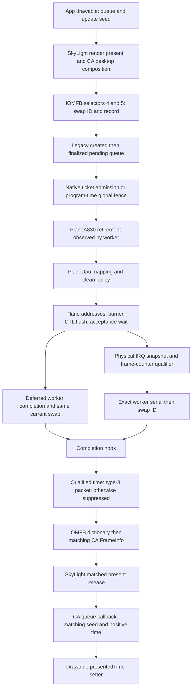

# macOS 27.3: 120 Hz swaps, frame identity and presentation feedback

**2026-11-27 · b1-m120-frameinfo-ana · analysis only · ONE change: HOLD.**
Both 120 Hz fix-image gates remain **HOLD**. Daily 120 Hz remains an owner decision.
The next step is bounded read-only `m120-diag` observation of retained evidence and host modeling,
with unavailable fields left unknown. This analysis authorizes no driver edit or image experiment.

The `v131y12t-m120d` result has two located failure mechanisms, but neither causal explanation is
closed end-to-end:

- **Feedback:** `same_frame` is **our PianoDpu audit reason**, not a SkyLight/IOMobileFramebuffer
  classification. It means the physical pre-flush and stable ISR frame-counter readings subtract
  to zero. Our qualifier then returns time zero and NativeGopDisplay suppresses the type-3 packet
  before macOS can inspect it. Why those counter readings are equal remains unknown.
- **Throughput:** depth-2 enablement produced **no new admitted ticket or demonstrated overlap**
  in the final loaded window. All 511 swaps selected the program-time global GPU watermark.
  The paired mean service is 17.237 ms, dominated by a 10.738 ms CPU-observed fence wait and
  6.095 ms CTL acceptance wait. The rejected admission predicate and surface-specific GPU timing
  remain unknown.
- **Drawable result:** all 3042 sampled `presentedTime` values are zero. Sparse successful kernel
  sends do not prove receipt, CA/SkyLight identity matching, or a positive time on those drawables.
  A presented handler can execute without the property's setter executing.

## Evidence, revisions and reproduction

Runtime numbers below are the retained evidence recorded in [November 27 results](../results-2026-11-27.md#120-hz-pipe--presented-time-probe-ram-v131y12t-m120d),
[throughput analysis](m120-throughput.md) and [presentation analysis](presented-time.md).
No fresh tablet observation is claimed. Keep these populations separate:

| Population | Evidence | What it establishes |
|---|---|---|
| 350 s RAM run | Both INTFs 119.994 Hz; 0 underruns; 0 WindowServer crashes; fixed-120 publication | Healthy physical scanout and nominal pacing contract, independently of new-frame throughput |
| Final loaded report, 10.008020 s | 511 PROGRAM / 511 complete-hook events; 739 software ticks; 511/511 pipe fallback | About 51 swaps/s in that window; no added load overlap |
| Separate 92.87 s FI window | 3286 programs/hooks; 99 valid/packets; 3187 missing; `same_frame=3186`, `before_flush=1`, `other_frame=1`; remaining reasons 0 | Qualification dominates loss; reason bits can overlap |
| Separate 60 s app probe | 50.71/s callback cadence; interval p50/p95/p99 20.81/27.85/28.20 ms; 4502 missed; 0 GPU errors; `zero_presented=3042/3042`, unique 0 | No positive drawable presentation series; callback cadence is not measured presentation cadence |

The captured source is **`3fcf74f45afc97876d7ea7ed80e85ab5cc345918`** (`lead/v131y12t`).
All source offsets and line numbers explicitly marked **captured** refer to that Git object, inspected
with `git show`; they do not describe this branch's older production tree. In particular, the current
tree's Unsupported `supported_frame_info` must not be substituted for the enabled captured implementation.
The relevant captured helpers are `GopFrameInfo.h`, `GopPacing.h`, `GopSwapPipe.h`, `GopFence.h`,
`GopRefresh.h`, `DpuFrameInfo.h` and `PianoDpuFrameInfoAudit.h`. There is no `GopFrameTime.h` in either
the current tree or the captured package inventory. The [offline diagnostic format](../../tooling/native/m120-diag/format.md)
is present here without production wiring.

This review directly reread the decoded **27.3 / 26C5035r arm64e** shared cache with `ipsw 3.1.745`,
and `com.apple.iokit.IOMobileGraphicsFamily` in the matching `kc273-mac17j.bin`.
The following image UUIDs identify Apple artifacts, not devices. Addresses throughout are unslid
static analysis anchors for these artifacts; they are not live pointers or a stable ABI.

| Image | Source version | LC_UUID |
|---|---|---|
| IOMobileFramebuffer | 700.51.10 | `6C5CADA8-314D-35A1-A861-D45563C0CBEA` |
| QuartzCore | 1223.20.4 | `3D77A93F-C7F5-367C-9234-35D19BC44944` |
| SkyLight | 959.4 | `331822B1-1C9F-367B-ADD2-310DDEEFF7C9` |
| CoreDisplay | 291.4 | `A60CA982-8804-3039-8271-88D8BDED9725` |

Reproduce read-only with externally supplied `IPSW`, `DSC` (the main cache file) and `KC` paths.
Keep binaries, symbol caches and instruction listings outside the checkout. For kernel disassembly,
`ANALYSIS_TMP` must name an external scratch directory; `--cache` prevents a write beside the input.

```sh
git show 3fcf74f45afc97876d7ea7ed80e85ab5cc345918:package/NativeGopDisplay/GopFrameInfo.h
git show 3fcf74f45afc97876d7ea7ed80e85ab5cc345918:package/PianoDpu/DpuFrameInfo.h
"$IPSW" dyld info "$DSC" --dylibs --no-color
"$IPSW" dyld macho "$DSC" QuartzCore --symbols --demangle --no-color
"$IPSW" dyld disass "$DSC" --vaddr 0x1b5ee09e8 --no-color
"$IPSW" dyld disass "$DSC" --vaddr 0x18e19415c --no-color
"$IPSW" dyld disass "$DSC" --vaddr 0x182ab5d08 --no-color
"$IPSW" dyld disass "$DSC" --vaddr 0x18e1086b4 --no-color
"$IPSW" macho disass "$KC" --fileset-entry com.apple.iokit.IOMobileGraphicsFamily --vaddr 0xfffffe000ac2e59c --cache "$ANALYSIS_TMP/family.a2s" --no-color
```

Optimized Objective-C calls require resolving the shared selector stub. For example,
`0x1900c1740` resolves to `updateSeed`, and `0x1900c0970` to `setPresentedTime:`.
Symbols alone do not establish that the installed process selected a branch.
No Apple payload or instruction listing is included in these documentation changes.

## Submission, ownership and completion path



The GPU fence happens before DPU access; the physical scanout event happens after programming.
They establish different facts. A resource-safe family completion is also distinct from a qualified
physical timestamp and from same-drawable feedback.

| Decoded anchor | Static contract | Captured implementation / limit |
|---|---|---|
| IOMFB `_kern_SwapBegin` `0x1b5ed9974`, `_kern_SwapEnd` `0x1b5ed9a40`, `_kern_SwapWait` `0x1b5ed9c64` | Selectors **4/5/6**; End submits a **0x830-byte** record; Wait takes three scalar inputs | Request acceptance is not latch or presentation. Do not use the older 0x46c record layout. |
| CA `IOMFBDisplay::finish_update` `0x18e1eeb28` | Calls `swap_end` at `0x18e1f0834`; waits at `0x18e1f0858` / `0x18e1f0870` are conditional | No unconditional submit-one/wait-one contract is proven. Actual policy branches/page availability are unknown. |
| Family `swap_start_gated` `0xfffffe000ac29660`, `swap_submit` `0xfffffe000ac29dc4` | Created requests are distinct from current and finalized pending requests | One current hardware-programming request does not imply one accepted request in the system. |
| Family `swap_queue_finalize_gated` `0xfffffe000ac2b208` | Applies fences at `...ac2b318`, moves created to pending at `...ac2b330` | Queue membership does not assert all producer-ready bits. |
| Family `swap_apply_fences_gated` `0xfffffe000ac2b410`, `io_fence_notify_gated` `0xfffffe000ac245e8`, `swap_signal_gated` `0xfffffe000ac2473c` | Missing/already-satisfied IOSurface fences set the layer-ready bit; asynchronous signals OR it into request +0x47c (including `...ac248b8–...ac248c0`) | This is a different fence phase from the A830 watermark wait after PROGRAM. A ready mask history is absent. |
| Captured Native `swap_begin_gated` / `clean_queue_gated` `:1427–:1466` | Prepare next ticket before current exclusion/filtering; filter obsolete/no-op/aborted/dummy heads; promote/program; prepare again afterward | The head used by preparation can differ from the head promoted after filtering. No preparation of that replacement is guaranteed between filtering and PROGRAM. |
| Captured Native `copyLoop :2627–:2653`, `jobDoneAction :2160–:2202` | One immutable GPU target; worker retains job surfaces; completion waits for job serial; exact FI serial is consumed under lock; current pointer is checked | A pending/ready ticket never grants producer completion, permits early surface release or eliminates the worker fence check. |
| Family `swap_complete_gated(bool)` `0xfffffe000ac26f9c` | Calls slot **462** at `...ac2707c` with the swap ID and null blob; later updates last-completed state, releases current at `...ac27368`, clears +0x2000 at `...ac2736c` | Native builds its own blob. A later clock call at `...ac27128` cannot retroactively supply its physical IRQ time. Native then drains the next request. |

**AppleParavirtDisplay boundary:** our queue/notification overrides follow the historical paravirtual
implementation, with ABI-2 family offsets. The examined 27.3 Mac collection's fileset inventory has
IOMobileGraphicsFamily but no AppleParavirtDisplay entry; that class is not a dyld userspace image.
The 27.0.1 paravirtual offsets and provenance in [NativeGopDisplay](native-gop-display.md#5a-layers-the-cursor-and-the-copy-race-2026-11-12)
are historical evidence, not a newly verified 27.3 paravirtual binary. This review checks the matching
27.3 family and userspace consumers. NativeGopDisplay, rather than an AppleParavirtDisplay host,
owns the physical DPU completion path here. A paravirtual nub does not prove SkyLight selected a
virtual-display policy.

## Why 3186 completions were `same_frame`

Captured `DpuFlip.h::flushTo :371–:387` reads **INTF1 FRAME_COUNT** before arming.
Both that `frames()` call and `DpuFlip.cpp::KernelHw::handler :309–:328` address
`kMdp + kIntfBase + kIntfStride + kIntfFrameCount`: base offset 0x34000, stride 0x1000,
FRAME_COUNT +0xac. The worker and ISR do not select different INTFs. LINE_COUNT +0xb0 and INTF2's
corresponding readings are useful missing phase evidence; they are not inputs to the current qualifier.

The exact order is:

1. Read `startFrame`. `frameInfoBegin` atomically publishes the CTL register address and returns
   continuous host ticks if IRQ observation is available. It does not clear Capture or assign a flush generation.
2. Arm the IRQ waiter, clear INTF1 VSYNC status and enable it. Write the new plane addresses/stride/format;
   barrier; write `CTL_FLUSH`; barrier. Sample continuous `flushed` time after that barrier.
3. Physical MDSS handler services/acks status. When armed and INTF1 VSYNC is present, it reads
   `frameBefore`, CTL, continuous time, `frameAfter`. Only an equal double-read records
   `Stamp{time, frameAfter, flush}`. The timestamp is a CPU IRQ-service observation, not a hardware first-pixel timestamp.
4. Worker `waitLatch` reads CTL until all requested bits clear, with IRQ wakeups or polling and a timeout.
   It records a separate microsecond readback time, disables/clears VSYNC, then disarms FI sampling.
5. `frameInfoEnd` takes a bounded consistent Capture snapshot and an end clock. The accepted time is
   the recorded IRQ time only when **all** of these conditions hold:

```text
flushed != 0 AND mask != 0 AND end >= flushed
AND flushed < irq.time <= end
AND uint32_t(irq.frame - startFrame) == 1
AND (irq.flush & mask) == 0
```

`SameFrame` is exactly `uint32_t(irq.frame - startFrame) == 0`; `OtherFrame` is a nonzero
advance other than 1. Modulo subtraction admits the normal uint32 wrap. Neither test examines an
app seed, IOSurface identity, IOMFB swap ID, family VBL count or repeated `presentedTime`.
Capture's odd/even `sequence` protects consistency of its three stored fields; it is not the physical
frame number or a flush/IRQ generation. The interrupt line count and waiter generation are separate again.

Successful CTL acceptance can therefore return `Shown` with FI time zero. After SMMU/underrun checks,
the worker publishes `{doneSerial, time-or-zero, rejectionBits}` under its copy lock. The work loop
takes the **exact** `fWaitSerial`, binds it to the still-current swap ID, and the completion hook consumes
that pending record. A zero time increments `missing` and returns NotReady **before dispatch**.
It is a suppressed packet, not a delivered zero-time packet.

The audit locates the immediate mechanism: 3186 equal-counter samples account for almost all 3187
missing records. Because `before_flush=1`, `other_frame=1` and all remaining rejection counts are zero,
at least **3185** of those equal-counter samples pass the other time/flush/presence predicates.
An ordinary retained pre-flush stamp cannot explain the dominant loss: it would also fail the time test.
Nor do the supplied counters implicate serial mismatch, swap mismatch, dropped hooks or transport errors.

The hardware cause is **unknown**. Equal reads are compatible with a stable 120 Hz counter if the
pre-flush read and CTL-accepted IRQ observation occur within the same counter interval. A phase ordering
in which VSYNC/fetch acceptance precedes FRAME_COUNT increment is one host-model hypothesis.
An in-window service timestamp for previously pending status, or an ISR already in flight across
disarm/rearm, is another identity question. The capture lacks raw frame/line pairs and per-flush IRQ
generation binding to select among them. It does not prove a stuck counter or a wrong register, and
does not justify accepting a zero advance. Host fixtures that assume `+1` at acceptance test the
predicate, not this hardware phase relationship.

## From type-3 ticks to the same drawable's `presentedTime`

The captured enabled schema supplies **two names in order**, `Presentation_time` and `Presentation_delta`.
Selector 74 enumerates them; selectors 72/73 register/change the type-3 subscription. Six capability
queries, one type-3 subscriber, masks `[3]`, three mask changes and zero bad masks establish that the
old Unsupported/no-subscriber diagnosis no longer explains this run.

For mask 3, `GopFrameInfo.h::pack` emits six async argument slots:

```text
[0x80000003, swapID, time.low32, time.high32, delta.low32, delta.high32]
```

The first delta is zero; later deltas span this subscriber's preceding **packed** nonzero time.
The packer rejects non-increasing time and updates request +0x80 before the CanDrop send returns.
Thus a delta is not necessarily one physical period, and accepted transport is not guaranteed receipt.
Here attempts/accepted/packets grew by 99, send errors by 0; the 3187 suppressed records never entered
that transport population. A reported accepted-time delta of 335.006 nominal periods measures sparse
qualified feedback, not the panel's refresh interval.

| Hop and decoded anchor | Fields and exact condition | What remains unknown in m120d |
|---|---|---|
| IOMFB `_InfoKeyInitialize` `0x1b5ed6938`, `IOMobileFramebufferFrameInfo` `0x1b5ed6fd8` / `_figure_frame_info_mask` `0x1b5ed70d4` | Successful selector-74 enumeration builds the name array; selection uses those names. A missing array is not repaired by a no-op state callback. | Which process consumes the observed subscription; same-packet receipt |
| IOMFB `_FrameInfoNotifyFunc` `0x1b5ee09e8` | Reads mask/ID, enumerates selected key bits using context +0xbc0, reconstructs halves with bit 31, builds a CF dictionary, calls registered function/context at +0x9b8/+0x980 | Actual ID/dictionary at receipt; CanDrop loss or consumer processing |
| IOMFB `_adjust_ni_timestamp` `0x1b5edfedc` | Context +0xc34 selects bypass versus adjustment; named absolute fields including `Presentation_time`, `Requested_presentation`, `Min_FrameTime`, `Max_FrameTime`, `Vbl_FrameTime` can use conversion callback +0xfc0. `Presentation_delta` is not in that timestamp-name list. | Selected clock mode/adjustment; do not conflate continuous ticks, absolute ticks and seconds |
| CA `IOMFBDisplay::collect_frame_info` `0x18e20003c` | Pending pointer vector +0x67d8/+0x67e0; matches the incoming **swap ID against FrameInfo +0**; retires older records. A matching in-flight ID at display +0x68a0 can take a condition-wait/retry path. | Exact matching record and whether the in-flight wait occurred |
| CA `IOMFBServer::frame_info_callback` `0x18e19415c` | Requires a collected record; examines record flags +0xdc. Reads `Presentation_time`, prefers **nonzero `Vbl_FrameTime`**, separately reads requested presentation; display +0x7857 controls a continuous/absolute offset adjustment using `mach_get_times`; `_CATimeWithHostTime` converts ticks for timing logic. | Record flags, selected clock domain and nonzero time for the same ID |
| CA `forward_frame_info_callback` `0x18e194a8c` | Independently reads the presentation/request/min/max/VBL dictionary fields. Callback metadata also comes from FrameInfo +0/+4, +0xc0, +0xd8 and +0xdc. Optional min/max are converted to offsets from presentation before forwarding. | A positive local timing choice does not prove the forwarded `Presentation_time` is positive; actual version/metadata and callback required |
| SkyLight `SLCADisplay::register_transaction_complete_callback` `0x182acad74`, adapter `0x182acae2c`, handler `0x182ab4c8c` | Registers CA `setFrameInfoCallback:`. Adapter copies the common CA callback prefix and gates extra fields at versions 1/3/4/5/6/7 (fields +0x28/+0x2c, +0x40, +0x48, +0x4c, +0x50/+0x58, +0x60). | Selected callback version, display flags and same-transaction delivery; semantic names of opaque extras are not inferred from offsets |
| SkyLight processing `0x182ab5d08` | Selects display's pending presents, scales supplied host ticks to seconds at `0x182ab5dc0`. For version >=4 compares pending `DisplayPresent +0x14`; older versions compare +0x10. A match writes time into retained `WSCAPresent +0` at `0x182ab5e7c`; unmatched stale records can be removed without that write. | Which completion identifier matched; whether the app's retained present received a nonzero value |
| SkyLight release `unique_ptr<WSCAPresent>::reset` `0x18272cd28`, vector destruction `0x182ab730c` | Releases the retained present through `CARenderPresentRelease`, carrying its stored timing doubles. Unfilled timing can remain zero. | Same render-present lifetime and time at release |
| CA `CARenderPresentRelease` `0x18e01f6dc`, `DisplayableObject::did_display` `0x18df3087c` | Leads to per-image-queue feedback: `__CACImageQueueDidPresent` `0x18e239628`, Mach message **0x9dd5**, receiver `__XImageQueueDidPresent` `0x18e239d18`, `invoke_presented_callback` `0x18e15b808` | Matching queue, update seed and time across server/client |
| CA `layer_presented` `0x18e1086b4` | At `0x18e1088a4–0x18e1088b0`, requires **time > 0 and drawable.updateSeed == callback seed** for the setter path; `setPresentedTime:` call at `0x18e1088ec`. Drawable seed getter `0x18e1081bc` reads +0x8c. | Actual branch on the 3042 drawables |
| CA drawable getter/setter `0x18e1081ac` / `0x18e1081b4` | Read/write the double at drawable **+0x68**. `didPresentAtTime:` `0x18e1067c0` drains handlers without writing that field. Cleanup/release paths may call it with zero. | Which absent/zero/mismatching feedback or cleanup path caused each zero |

There is no single universal "frame generation" field shared across this chain. The required joins are
app queue/update seed → retained render present/CA transaction → IOMFB swap ID → our worker serial →
physical flush/IRQ sample, and back through the corresponding records. Hardware FRAME_COUNT is never
sent in our two-key packet. Family VBL count is not the callback seed. Replacing any of these joins with
"the next callback" would manufacture an association.

The binary also contains `IOMFBDisplay::presents_metal_layer_on_finish` (`0x18e1ed1bc`): it returns true
for an absent +0x68b0 object or that object's +0x14c bit 0; otherwise it consults the selected entry under
display +0x6730/+0x66e0 and entry +0x55 bit 2. Its runtime selection is unobserved. Therefore suppression
is a proven major kernel feedback defect, but it is insufficient to assign **all 3042** zeros exclusively
to SameFrame or to promise that fixing qualification alone reaches the drawable setter.

## Why depth-2 did not remove the 17.24 ms service time

Captured `GopSwapPipe.h::eligible` and Native `prepareQueuedFence :2445` require:

```text
finalized pending head exists
AND raw uint32 layers == 1
AND (raw readyLayers & 1) != 0
AND (raw dropReasons & ~8u) == 0
AND mainSurface != null
```

Preparation runs before cursor masking and queue filtering. A new `{request, surface, swapID}` key
retains the request and freezes the **global** A830 submitted sequence; repeated preparation does not
chase later ring work. The 1 ms timer queries retirement without sleeping or accessing pixels/DPU.
PROGRAM consumes only a matching Pending/Ready ticket; otherwise `take` counts fallback and uses
the original program-time watermark. `pending_used` is a successful take with a residual worker wait,
not fallback. "Depth-2" is one next readiness ticket alongside the family's one current swap, not two
concurrent DPU programming workers or a proven WindowServer queue capacity.

In the final window `captured=1716`, `used=1715`, `polls=3100`, `ready=258`, `pending_used=1458`,
`cancelled=1`, `failed=0`, `overlapped=235` and `overlap_us=406721` all stayed unchanged;
`fallback` alone advanced **2403→2914**. Startup totals do not prove load overlap. No new capture
failures, deadline failures or cancellations explain this plateau. The retained report also records
198 observations of current plus pending, so universal depth-one submission is contradicted.
That is a lower bound on occupancy, not 198 distinct requests or a maximum depth.

The raw ready/layer/drop/head history is missing. A readiness timing failure or head replacement after
filtering is consistent with the source, but neither is selected by the rollups. An eligible first head
could be captured immediately before promotion even without an earlier outstanding request; hence
"WindowServer only submits one" alone would not explain 511/511 fallback.

| Paired stage, 511 swaps | Mean µs | Range µs | Attribution |
|---|---:|---:|---|
| PROGRAM → worker fence start | 29 | 8–63 | Dispatch/wakeup overhead |
| Fence start → target observed retired | **10738** | 6894–12219 | GPU queue/execution ahead of global target **plus** CPU query/poll/scheduling observation delay |
| Fence observed → flush-wait start | 331 | 104–393 | Mapping/admission/cache policy/program overhead; `clean` mean 318 µs (94–378) is a **subset** |
| Flush-wait start → first CTL-clear readback | **6095** | 32–8289 | Remaining latch phase plus IRQ/poll scheduling and readback; not a hardware event timestamp |
| CTL-clear readback → complete hook | 43 | 12–2208 | Worker completion/work-loop handoff; worker-done → hook mean 32 µs is a **subset** |
| PROGRAM → complete hook | **17237** | 8299–21092 | Paired stage total 8,808,549 µs; only 1/511 is below 8333 µs. Reported integer component means differ by 1 µs. |

`PianoDpuFlipTiming.flushUs` is the `waitLatch` entry clock just after program/barriers; the FI lower
bound is a separate continuous-tick sample after the barrier. The table uses microsecond software
observation endpoints, not the FI IRQ clock. The family IOSurface-fence phase precedes PROGRAM and
is outside this budget. The worker waits once; DPU gets `producerComplete`, not a second A830 wait.
All 511 loaded flips were direct, with zero CPU-copy fallbacks/cursor-forced copies.

At 120 Hz one period is 8.333 ms; at 60 Hz it is 16.667 ms. CTL acceptance waits for the remaining
scanout phase, rather than imposing a fixed 8.33/16.67 ms sleep. The measured maximum 8.289 ms and
mean 6.095 ms do not indicate a hidden 60 Hz latch. Fence wait alone already exceeds a 120 Hz period.
Without overlap, fence plus remaining latch phase readily spans two 120 Hz periods. Exact phase and
per-swap GPU retirement remain unmeasured.

The reciprocal of 17.237 ms is about **58.0/s**, not 50.71/s. PROGRAM/complete spacing averages
19.569 ms (about 51.1/s), and the app cadence comes from a separate 60 s population. Thus service time
is over budget, with additional producer/CA/readiness gaps possible; these aggregates establish no
hard 50/60 fps cap or exact skipped-display-link pattern.

### GPU wait versus rendering, and M2 clean versus cache checks

Captured `NativeAdrenoPublish.cpp::native_adreno_fences :2174` reads ring `lastSubmitted`, recorded
completion and fresh CP `memptrs[1]` (+4), choosing the newer retired value with signed modulo-32
comparison. It is lock-free and neither submits a job nor waits for a GPU mutex. `GopFence.h::wait`
tests `int32_t(retired - immutableTarget) >= 0`, polls at 1 ms and has a 1000 ms hang budget.
Successful timer queries do not themselves advance the GPU fence.

The retained load diagnostics show 511 legacy waits and 4769 sleeps, totaling 5,477,771 µs sleeping
against 5,487,141 µs stage-fence time (99.83%; about 1.149 ms/sleep; none over 2 ms).
This does not mean sleeping added 10.74 ms after GPU execution: the GPU can progress during those
sleeps. Actual retirement is only bounded by the last pending and first retired queries.
Ring job depth 3 and roughly two render-server jobs per external submission are not framebuffer
depth or a swap-specific execution measurement. The retained accountant's `polled=1` service estimates
cannot assign exact hardware start/end times to a particular desktop surface. Do not import the older
probe's sub-millisecond app pass or a different benchmark's render time as this composition's cost.

The independent RAM-qualified [M2 result](../results-2026-11-27.md#v131y12u-m2opt2-2026-11-27)
with `piano-dpu-clean-skip=1` reduced **pixel-clean** cost from 3864.24 µs to 0.95 µs per shown flip:
one initialization plus 2466 verified-WC skips, 0 underruns, 0 copies and 0 WindowServer crashes.
WC verification separately cost 671,358 µs over 2467 flips (about 272 µs/flip). The captured m120d
`clean=318 µs` field includes clean-policy/WC checks; it is not evidence of a recurring 3.86 ms full clean.
Do not add that subset again to the stage budget or add the M2 workload's 0.95 µs as another stage.
M2 does not remove GPU queueing or CTL phase wait and does not qualify daily 120 Hz.

## 120 Hz mode contract and the three VBL mechanisms

| Mechanism | Producer → consumer | Verified contract / limitation |
|---|---|---|
| Physical scanout | DSI0/1 and INTF1/2 timing → panel; FRAME_COUNT motion | `piano-dpu-modes=120`, verified ACTIVE 120, both links 119.994 Hz. Stable physical periods can scan the same desktop repeatedly. |
| Software queue-service timer | `vblFired` → Native `swap_begin_gated` | Absolute `GopRefresh::nextDeadline` grid, period converted from 8,333,333 ns. Keeps a future deadline, skips expired ones, resets after a long stop; can stop at idle/off/disconnect. No physical VBL count/time or type-5 packet is produced. |
| Family hardware-VBL accounting/notification | `note_vbl_ISR` → family count/time/delta and notification machinery → IOMFB/CA | A separate hardware-event path. Our DPU ISR records its private FI Capture and wakes the worker; it does not call Native/family `note_vbl_ISR` or emit continuous timestamped type-5 vsync. |

Captured `createDisplayAttributes :3436–:3487` verifies the DPU mode before registration, publishes
the refresh dictionary and checks all six fields before exposing the timing. The timing element
stores **120<<16 at raw +56**. `GopRefresh::fixedAttributes` and virtual slot **423** supply:

| RefreshTimingAttributes word / dictionary key | Fixed-120 value | Status |
|---|---|---|
| 0 / `displayMinRefreshInterval` | `0x02222222`, floor(2^32/120), 32.32 seconds | ours-OK |
| 1 / `displayMinRefreshIntervalMachTime` | 199999 host ticks in the capture, from converted 8,333,333 ns | ours-OK |
| 2 / `displayMaxRefreshInterval` | Same fixed period as minimum | ours-OK |
| 3 / `displayMaxRefreshIntervalMachTime` | Same tick interval as minimum | ours-OK |
| 4 / `displayRefreshStep` | 0 | ours-OK |
| 5 / `displayRefreshStepMachTime` | 0 | ours-OK |

The matching family's default `get_timing_attributes_gated` (`0xfffffe000ac32880`) has a 60 Hz minimum
(`0x04444444`) and a conditional 60/24 Hz maximum. Its `setDisplayRefreshProperties`
(`0xfffffe000ac329d0`) calls the override and publishes the six keys. Native's override matters even
when the timing element already says 120 Hz. These interval values describe a nominal fixed rate;
they are not advancing event timestamps.

Decoded CA `AppleDisplay::update_display_limits` (`0x18def6b4c`, property read at `0x18def7ad4`)
stores `displayMinRefreshInterval` at display +0x7a08 and derives +0x7a10 from the step-Mach-time
property, subject to feature policy. `AppleInternalDisplay::heartbeat_rate` (`0x18defb710`) considers
cached/override/step/minimum and per-mode refresh inputs. Its branch includes other display flags;
this is no proof of an unconditional 60 Hz clamp. Actual selected heartbeat/readiness policy is unknown.

The family `note_vbl_ISR` (`0xfffffe000ac2e59c`) increments +0x100 (and +0xf8), stores time/delta
at **+0x108/+0x110**, and tracks additional timing at +0x120/+0x128. That +0x108 is the old blob's
`kSwapInfoTime`, not a physical timestamp magically supplied by `swap_complete_gated`.
The enabled captured FI path explicitly replaces old blob words with qualified IRQ time.
The software timer's count, the physical INTF counter and this family VBL count are distinct series.

Type-5 decoder `_IOMobileFramebufferVsyncNotifyFunc` (`0x1b5ee0c84`) reconstructs three 64-bit values
from six half-word slots and adjusts the second time through the connection callback. CA
`IOMFBServer::vsync_callback` (`0x18e192790`) uses that time and interval for timing/readiness state
and a next-time calculation. Enabling named type-3 FI does not supply this separate type-5 source.
The 739 software tick samples averaged 13.542 ms (7.319–22.465 ms); zero wakes above a 20 ms lateness
threshold cannot exclude missed 8.33 ms deadlines. Neither missing type-5 wiring nor this tick average
alone proves the observed app cadence's causal branch.

CoreDisplay provides a parallel display abstraction, not evidence of an automatic timestamp repair:
`Display::SetVBLInfo` (`0x18458cb3c`) stores its two caller-supplied values at +0x288/+0x290 and mirrors
them into an attached structure. `_CoreDisplay_Display_GetRefreshTiming_Server` (`0x184586134`)
delegates to a backend function (or returns zeros when no device exists); `UpdateDisplayMode`
(`0x1845926bc`) selects backend mode operations. Those functions neither generate the qualified
PianoDpu IRQ time nor establish the app's seed match. The selected CoreDisplay backend/runtime
callers for this display remain unknown; do not substitute an IOFramebuffer/IOPresentment contract
for the observed CA→IOMFB selector path.

`DpuRefresh.h`'s optional VFP policy is a different mechanism from this fixed-mode run: it changes
DSI/INTF totals together, waits for CTL interface-flush acceptance, verifies both links and can revert.
Its nominal 120/60 totals are 2310/4620 lines, with programmable-fetch restrictions. The m120d
`prog-fetch 0013b6c1`/ACTIVE evidence belongs to the verified fixed-mode path; the optional policy is
not evidence of a hidden mode switch during this run.

## Complete Check Matrix

**ours-OK** means the specific implementation/observation is established, not that its entire hop passes.
**ours-missing** identifies an absent facility or required evidence. **unknown** marks an unobserved
runtime value, opaque field meaning or causal relation. The inventory covers fields used by this
swap/FI path, callbacks, barriers and tick sources. Undecoded private record bytes are explicitly unknown;
this is not a claim to recover every member of Apple's private C++ types.

### Request, queue, job and fence fields

| Check / field inventory | Status | Evidence / remaining check |
|---|---|---|
| FI/pipe enable predicates: argument exactly 1, ABI 2, internal, requested/active 120, fixed contract, direct flip, defer-always, GPU fences/symbol; audit argument exactly 1 with FI active | ours-OK | Captured startup checks and enabled run. Enablement alone establishes neither eligible heads nor qualified events. |
| Swap record size, selector 4 ID, selector 5 submission, selector 6 wait | ours-OK | Decoded 27.3 ABI; accepted swaps. Per-ID selector clocks are ours-missing. |
| All other 0x830 record fields, scheduling timestamps/event waits/signals and their live values | unknown | Only consumed fields/relationships are established here. Requested timestamps from `SwapSetTimestamp(s)` (`0x1b5eda428` / `0x1b5eda4ac`) are inputs, never actual presentation evidence. |
| Family current +0x2000; pending first/last +0x2008/+0x2010; created first +0x2018; request next/prev +0xfc8/+0xfd0 | ours-OK | Separate ownership/queues. Full occupancy history and maximum depth are unknown. |
| Request swap ID +0x474, raw layer mask +0x478, ready mask +0x47c, drop reasons +0x48c, main surface +0xd08 (+8 per layer) | ours-OK | ABI-2 source and matching family accesses. Load-time predicate tuples are ours-missing. |
| Finalized head eligibility and post-filter head identity | unknown | No successful captures in load; no rejection-field history to distinguish ready-bit failure, changed head or another predicate. |
| Source/destination rectangles +17/+81 (+16 per layer); cursor x/y +97/+101; dirty rectangle +417 and valid bit +552 | ours-OK | Native composition inputs. They carry geometry/damage, not presentation identity; per-swap raw values unrecorded. |
| Job `kind, refresh, last, fenced, fence, flip, frameAll, frameDamage, overlayChanged, base, overlay, x1, y1, serial` | ours-OK | `GopCompose.h`; retained snapshot; serial order; separate swap/refresh behavior. Exact app-surface association is unknown. |
| Layer change `taken/released`, slot `busy/job`, Busy `serial/base/overlay/refresh`, Admission `hadJob/offer/displaced/waitSerial/abortBusy` | ours-OK | Lock-protected admission and surface retention; defer prevents releasing a surface still read/scanned. No early completion selected. |
| Ticket Key `request/surface/swapID`; Slot `key/state/fence/beganUs/pendingThroughUs`; Pending/Ready/Failed/Empty transitions | ours-OK | Immutable target, retained request, bounded polls and matching take; power/cleanup/head changes clear it. Real admission history is ours-missing. |
| Pipe `captured/polls/ready/used/pendingUsed/fallback/cancelled/failed/leadUs/overlapped/overlapUs` | ours-OK | Separate cumulative deltas; only fallback grows during final load. `used` alone is not overlap proof. |
| Family IOSurface ready signal versus Native global target | unknown | Two independent fence phases; missing same-surface signal/target/job correlation. |
| A830 submitted, recorded completed, fresh `memptrs[1]`, wrap-safe target comparison | ours-OK | Conservative producer guard; provider query is not GPU work or an event timestamp. |
| GPU exclusive execution, queue delay, actual retirement and observation lag for a swap | ours-missing | CPU poll interval bounds only. `A830Fence::queueCompleted` accounting under polled retirement is not per-job hardware timing. |
| WorkerTiming `serial/fenceStartUs/fenceEndUs/flushUs/latchUs/cleanUs/doneUs`, PROGRAM/hook pairing | ours-OK | All 511 paired stages ordered/present. `clean` and gate durations are subsets, not extra terms. |

### DPU request, barriers and physical event fields

| Check / field inventory | Status | Evidence / remaining check |
|---|---|---|
| `PianoDpuFlipRequest.size/version` | ours-OK | ABI v1 validation; optional outputs are separate parameters. |
| Request `surface/memory/offset/rowBytes/width/height/format/planes/copyUs` | ours-OK | Native obtains IOSurface layout, validates direct/normalized linear BGRA; DPU validates size/stride/alignment/planes and backing. `copyUs` estimates saved work, not presentation time. |
| Request outputs `result/latchUs/workUs` | ours-OK | Result distinguishes Shown/refusal/failure/paused; durations cannot be used as absolute time. |
| Handoff `producerComplete` | ours-OK | Only an answered and retired immutable target covers the job. A missing provider may allow existing fallback behavior but cannot yield qualified FI; `NoCoverage`/`ProviderUnavailable` audit it. |
| SMMU windows, retained/wired backing, table visibility and previous scanout lifetime | ours-OK | DPU admission/mapping/clean epochs and CTL acceptance precede previous-window release. No load copies/fault evidence. |
| Strict WC epoch: initialization clean, current attributes/backing check, producer completion, fallback clean | ours-OK | M2 separately RAM-qualified; skip does not remove eligibility checks or producer fence. |
| Plane address/stride/format writes → barrier → CTL flush → barrier | ours-OK | `Flipper::program`; ordering exists. Actual physical increment/acceptance/IRQ phase is unknown. |
| `waitLatch`: requested CTL bits clear, timeout, IRQ wake/poll fallback; SMMU/underrun checks | ours-OK | Safe latch completion established independently of FI qualification. A readback is not first pixel. |
| `PianoDpuFlipTiming.flushUs/latchObservedUs/cleanUs` | ours-OK | Software microsecond observations; populated on successful new-surface latch. Same-surface reshow is separate. |
| `PianoDpuFrameInfo.size/version/supported/reserved/continuousTime` | ours-OK | Optional fourth parameter validated; audit request/response markers distinguish absent support from rejection; time is qualified continuous IRQ-observation ticks or zero. |
| Arm CTL address, `startFrame`, post-barrier `flushed`, qualifier `end`, flush mask | ours-OK | Source predicates explicit; per-event historic values are ours-missing. |
| Stamp `time/frame/flush`; Capture `sequence/frame/flush/time`, four bounded read attempts | ours-OK | Stable double hardware read and atomic consistency snapshot. Sequence is not a physical generation. |
| INTF1 frame +0xac versus INTF2 frame/line and INTF1 line +0xb0 | unknown | Same INTF1 register used by worker/ISR; raw two-link phase pairs are ours-missing. No proven wrong-register cause. |
| IRQ line count, waiter generation, Capture sequence, worker serial, hardware count kept distinct | ours-OK | Distinct source roles. A per-flush selected physical IRQ-generation join is ours-missing. |
| Time/CTL bounds and exact modulo `+1` predicate | ours-OK | Rejection policy located. Reliable new-surface timestamp coverage is ours-missing; counter phase cause is unknown. |
| Audit bits `NotArmed/NoSample/ClockBack/BeforeFlush/AfterEnd/SameFrame/OtherFrame/FlushPending` | ours-OK | Physical predicates counted independently; overlap preserved. SameFrame dominates. |
| Audit bits `NotNew/FlipFailed/NoCoverage/NotDirect/ProviderUnavailable/SerialMismatch/SwapMismatch/NoHandoff/Dropped` | ours-OK | Exclusions/handoff/drop paths accounted for; zero growth in the supplied FI window does not universally certify those paths. |
| Disarm/disable versus in-flight ISR, pending-status service and retained Capture freshness | unknown | Ordinary old time is rejected; no generation/phase tuple to settle remaining races. |

### Completion, notification, macOS identity and VBL fields

| Check / field inventory | Status | Evidence / remaining check |
|---|---|---|
| Completion `serial/time/rejected`, Pending `swap/time/rejected`; exact wait serial/current pointer/ID | ours-OK | Consumed once under lock/gate; zero mismatch reasons in window. Does not establish downstream matching. |
| Type-3 schema `count=2`, 64-byte names, flags=0, tag bits 0/1, split bit 31 | ours-OK | Captured enumeration and observed subscriber mask 3. Disabled old-tree path is different. |
| Notify request async reference +24, linked flag +116, mask +120, previous time +128; lists display +8232 (+16/type) | ours-OK | Captured gated subscription snapshot and send path; enable/state resets previous time. |
| SwapInfo `swapID/words[5]`, enabled `words[0]=qualified time`, remaining words zero; held-ring handling | ours-OK | Enabled path overrides opaque legacy time/words from display +264 and request +1072/+1136. ABI-2 treats historical paravirtual held-tail field as absent. |
| Mask/ID/time halves/delta halves, monotonic packing, CanDrop send and error counters | ours-OK | 99 accepted sends, 0 errors. Receipt and decoder output are unknown. |
| `Presentation_time` | ours-missing | Only 99/3286 kernel completions have qualified time; app has no positive series. Sparse transport is ours-OK, same-drawable propagation unknown. |
| `Presentation_delta` | ours-OK | Per-subscriber packed-time difference; not necessarily the mode period. Not a substitute frame identity. |
| Optional `Vbl_FrameTime/Requested_presentation/Min_FrameTime/Max_FrameTime` feedback keys | ours-missing | Our schema does not advertise them. Their absence is not proof they are mandatory for the positive `Presentation_time` path; consumer selection remains unknown. |
| Clock mode +0xc34/converter +0xfc0; CA +0x7857 offset branch; ticks→seconds | unknown | Static conversions located; same-event installed values unobserved, especially across suspend. Never substitute worker completion or requested time. |
| CA pending FrameInfo swap ID +0, metadata +4/+0xc0/+0xd8/+0xdc; vector/in-flight ID | unknown | Static matching path established; matching record and flag branch missing from capture. |
| CA callback registration/version, SkyLight completion identifiers, retained WSCAPresent timing | unknown | Versioned adapter and release path decoded; runtime same-transaction proof absent. |
| Image queue identity, callback seed, drawable +0x8c seed, +0x68 presented time | ours-missing | No joined queue/seed/positive-time series. Setter requirements decoded; zero callback cleanup branch unknown. |
| App handler reads `shown.presentedTime` inside callback | ours-OK | Probe reads property directly; callback arrival time is a different metric. |
| Mode timing +56; all six RefreshTimingAttributes words/keys; verified rate before registration | ours-OK | Fixed 120 readback contract. Active CA heartbeat/readiness policy is unknown. |
| Physical FRAME_COUNT cadence and dual-link agreement | ours-OK | 119.994 Hz, no underruns; does not count distinct new desktop/app frames. |
| Software VBL deadline/tick/idle stops | ours-OK | Timer scheduling implementation; 739 ticks are not physical scanouts. |
| Family VBL count +0x100, time +0x108, delta +0x110; hardware note path | ours-missing | No DPU→Native/family physical tick bridge. Static writer located; no invented tick/time update selected. |
| Timestamped continuous type-5 source and selected CA vsync consumer | ours-missing | No continuous source in our adapter; consumer selection/impact unknown. Cleanup dispatch is not a physical source. |
| CoreDisplay VBL pair/backend timing versus IOMFB path | unknown | Caller-supplied separate state; no proof of automatic feedback repair or a 60 Hz clamp. |
| Positive, distinct 120/s same-drawable presentations and admitted overlapping load pipeline | ours-missing | Both qualification gates remain HOLD despite the physical scanout pass. |

## Bounded next evidence and host models

Use the existing [m120-diag format and grader](../../tooling/native/m120-diag/format.md) on retained
artifacts first. Its raw records are a prospective observation contract, **not wired emitters on this
branch**. Recognized aggregate records do not reconstruct missing fields. A grader return of 2 means
unavailable evidence; it must not be promoted to a pass. No new boot, hook, tracing enablement,
notification registration, mode/argument change or driver wiring is selected here.

| Question to settle | Bounded observation / host comparison | Closure criterion |
|---|---|---|
| Which ticket predicate failed? | Same-boot `pipe` rows: last preparation and post-filter PROGRAM samples, raw layers/ready/drops, current/created/pending/head IDs, key match, ticket state and take result | Partition fallback by observed predicate or replacement; preserve unknown when a sample is absent. Model both ready-before/after-preparation and filtered-head replacement. |
| What does the global target cover? | Same-worker/swap capture and program targets, submitted/retired values, last-pending/first-retired query clocks, family main-fence signal and completion | Distinguish producer work, unrelated ring tail and CPU observation interval; surface-specific GPU execution still requires separate evidence. Model queue lead/poll phase using measured bounds, not assumed 120/s readiness. |
| Why is the physical count equal? | Same-flush `flush` and exact selected `irq` generation: pre-flush INTF1/2 frame/line, arm/enable/flush/readback/disable/disarm/end clocks, IRQ status/time/CTL and stable/unstable frame pairs | Compare accepted +1 versus equal-counter events and both links modulo 2^32. Model counter increment before/after acceptance, delayed IRQ service and in-flight ISR ordering without relaxing the qualifier. |
| Where is positive feedback lost? | One accepted packet's ID/time at IOMFB receive/dictionary, CA collect/clock branch/versioned callback, SkyLight match/release, app queue/seed/setter; separately follow a suppressed event | Same-event receipt and positive matching value at every join. Offline pipe/flush/irq records alone cannot establish userland propagation. |
| Which tick/readiness policy schedules the next frame? | Separate existing physical counter snapshots, software ticks, family VBL state/type-5 subscriptions, CA readiness/wait/page occupancy and display flags | Same-window policy evidence; no inference of depth, 60 Hz cap or skip count from nominal period alone. |

The existing conditional depth-2 host model assumed an eligible, ready rotating head and a 120/s
producer. Its successful 120/s result did not establish those assumptions on the tablet. Likewise a
host FI test with `irq.frame = startFrame + 1` cannot qualify the physical edge relationship. Further
host work must exercise the missing states above and leave measured and hypothetical timelines distinct.

## Fix-image gate

```text
Path: app drawable queue/update seed -> SkyLight retained render present / CA
      composition and page -> IOMFB selectors 4/5 -> Legacy created/finalized
      pending request and IOSurface-ready mask -> Native ticket or fallback
      global A830 target -> worker retirement observation -> DPU mapping / WC
      clean policy -> plane stores / barrier / CTL_FLUSH / barrier -> CTL
      acceptance plus separately qualified physical INTF1 IRQ -> exact worker
      serial / current swap ID -> type-3 packet -> IOMFB clock-adjusted
      dictionary -> CA matching FrameInfo / callback -> SkyLight matching
      present release -> image-queue seed match / positive time -> drawable.
Checks: ours-OK fixed-120 hardware/publication, conservative fence and surface
        lifetime, ordered CTL acceptance, explicit FI predicate/handoff/schema
        and 99 accepted sends; ours-missing load ticket admission/overlap,
        reliable physical FI coverage, per-flush IRQ-generation/counter pairs,
        surface-specific GPU timing, continuous family/type-5 physical VBL and
        positive same-drawable feedback; unknown rejected head predicate,
        hardware counter/acceptance/IRQ phase, clock/policy branches and
        downstream receive/transaction/seed matching. See Complete Check Matrix.
Root cause: 511/511 fallback removes the modeled load overlap; 10.738 ms
            CPU-observed global-fence wait plus 6.095 ms latch observation
            dominates 17.237 ms service. SameFrame is our zero counter-advance
            rejection, suppressing 3186 records before userspace. Physical
            counter phase, failed admission condition, GPU attribution and the
            exact all-zero drawable branch remain unproven. No single causal
            correction closes both gates.
Next: bounded read-only m120-diag review of retained evidence and host models;
      missing historic fields remain unknown. No premature fix image, relaxed
      qualifier, fabricated timestamp, earlier completion or driver wiring.
Owner gate: both 120 Hz fix-image gates HOLD; daily 120 Hz is an owner decision.
           Documentation only; no package/private edits, image or push.
ONE change: HOLD
```
