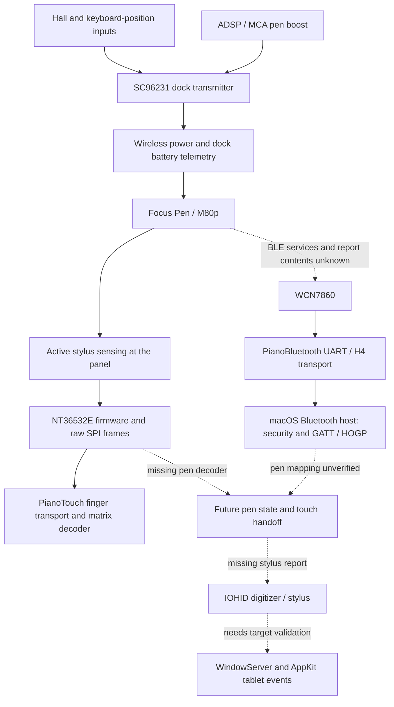

# Xiaomi Focus Pen / M80p: static path analysis

Analysis date: **2026-11-27**. Target: Xiaomi Pad 8 Pro (`piano`, SM8750),
macOS 27.3 (`26C5035r`). **Analysis only; no tablet access or pen qualification.**
Pen work stays postponed until the daily items and **Goal 11 Bluetooth hands-on
pairing** close, followed by a separately scheduled, owner-attended pen session.
The [hardware backlog](../BACKLOG-hardware.md#3-order-does-not-preempt-the-power-work)
puts daily power, battery and owner checks first and explicitly excludes stylus
work from its current scope. Goal 11 is the prerequisite named for this analysis;
the repository tracks the corresponding pairing work under B9 and the
[Bluetooth owner session](../tools/bt-session.md).

## Scope, pins and evidence rules

The inspected Darwin sources are those at repository commit
`c332164f6845db5b423404b4496469449742502b`. The Ubuntu reference is
`linux-sm8750-piano` at **`7f8d6bedde479a01f4a05d6d0581b43c7fd20a01`**.
All Linux citations below refer to that object, read with `git show`/`git grep`
against the commit, independently of the reference checkout's working files.
Relative source links refer to this repository; Linux links contain the full
commit and repository-relative path. No firmware, calibration, peer identity or
bond material is reproduced.

Three findings set the limits of the analysis:

1. **The implemented touch controller is Novatek NT36532E THP, not FTS.**
   The board DTS names `novatek,nt36532e`; our parser reads raw electrode
   matrices, then derives finger contacts. There is no FocalTech/FTS pen report
   parser in this path. [Board touchscreen][k-touch-dt];
   [Nt36532.h:Chip, readFrame, packetFields][t-protocol];
   [TouchMatrix.h:matrixFeed][t-matrix].
2. **Bluetooth pressure and button transport is unproven.** PianoBluetooth
   supplies HCI transport to Apple's host stack, not a native ATT/GATT/HOGP
   implementation. Neither these packages nor the pinned THP transport contains
   an M80p BLE Report Map. Pressure, tilt, hover and side-button ownership must
   be established from source or attended captures; they cannot be assigned to
   BLE merely because the pen pairs. [PianoBluetooth.cpp:publishRadio, pump][b-driver];
   [HciH4.h:LeReadyAssist][b-h4]; [Linux THP transport][k-thp-core].
3. **Magnetic charging has a concrete Linux reference.** The board describes
   Southchip SC96231, its Hall inputs and a charger-managed 6.5 V boost supply.
   Linux also reads pen battery state and a Bluetooth address over this charging
   interface. These are source facts, not evidence of Darwin support or a working
   BLE connection. [Dock DTS][k-dock-dt]; [boost supply][k-boost-dt];
   [SC96231 binding][k-dock-binding];
   [sc96231_update_pen][k-dock-telemetry].

Here, **verified in source** means the cited implementation or DTS contains the
fact; it does not mean tested on this tablet. **Inferred** identifies a proposed
connection between documented pieces. **Unknown** means the inspected evidence
does not settle the question. Product name Focus Pen / M80p is the task's target;
the Linux API spells its controller model `M80P`. An owner's actual pen model
and firmware still need confirmation. [piano-touch.h][k-touch-uapi].

## End-to-end path and its breaks

Solid connections describe source-backed subsystems; dotted connections mark
missing or unverified pen-specific boundaries. The diagram does **not** establish
that coordinates use SPI while pressure uses BLE. There may be one authoritative
pen report stream, separate control and telemetry streams, or a vendor protocol
requiring processing outside the kernel. Selecting among them remains open.
[THP stream contract][k-thp-readme]; [H4 transport][b-driver];
[charging telemetry][k-dock-telemetry].

## Panel, SPI reports and scan control

### Hardware and transport already present

The board's `spi2/touchscreen@0` uses SPI chip select 0, a 19.2 MHz maximum,
TLMM GPIO162 rising-edge interrupt and GPIO100 for panel-module selection.
Firmware names select CSOT or BOE. The SoC node is QUP1 SE2, `spi@a88000`,
GIC SPI 355, with `GCC_QUPV3_WRAP1_S2_CLK` and GPI DMA channels for SE2.
These are DTS facts; 19.2 MHz is a ceiling, not an assertion of our active bus
rate. The base board gates the touchscreen off; the desktop DTS enables it.
[Board touchscreen][k-touch-dt]; [SM8750 SPI node][k-spi];
[desktop enablement][k-desktop].

Our implementation supplies the GENI SPI engine, DMA/cache handling and GPIO
IRQ/latch handling, identifies the NT36532 variant, downloads the selected
host firmware into controller SRAM and starts capture. It maps the touch bus to
GPIO40–43 and uses the QUP1 stream `0xa3`. Panel power and timing matter because
this is a touch/display integrated controller. The Linux panel follower stops
capture before panel disable and reruns its startup sequence after panel enable.
[PianoTouch.cpp:geniUp, firmware, startScanning, armIrq][t-driver];
[GeniSpi.c][t-spi]; [Linux panel/stream contract][k-thp-readme].

The normal Darwin frame path follows announced frames through GPIO162's edge
or asserted level. `TouchPace.h:readOn` also contains blind-read fallbacks when
the latch is unavailable and an opt-in `piano-touch-noedge` mode; therefore
"never reads without an IRQ" is too strong for all configurations. The
default no-edge argument is zero. Pen work must preserve the existing pacing
and measure scan behavior before changing it. [TouchPace.h:ReadCue, readOn][t-pace];
[PianoTouch.cpp:readArgs, serve][t-driver].

### What the SPI report actually contains

`Nt36532.h` pages addresses using `ff, address >> 15, address >> 7`.
Writes set bit 7 in the offset; reads send the low seven-bit offset and a dummy
byte, then take received data after those two bytes. The cascade-E event
buffer is `0x11c400`; payload length comes from firmware poll information at
`0x1093d8`, not from a fixed assumption about a pen report size.
[Nt36532.h:setPage, read, write, identify, start][t-protocol].

The assembled frame has a zero placeholder followed by 256 bytes of controller
prefix, then the THP payload. Below, offsets are from the start of that payload,
`frame + 257`, **not** from the start of the SPI transaction.
[Nt36532.h:kTransportBytes, frameBytes, readFrame, packetChecksum, packetFields][t-protocol];
[PianoTouch.cpp:frame][t-driver].

| Payload offset | Interpretation in our parser |
|---|---|
| `+0` | Protocol marker, logged as a byte. Linux validity checks require `0xa5`. |
| `+2` | Little-endian 16-bit packet counter. |
| `+4`, `+12` | 16-bit checksum and its complement. |
| `+8`, `+16` | 32-bit checksum-region length in words and its complement. |
| `+20` | Start of covered region: `words * 4` bytes; its 16-bit word sum cancels the checksum modulo 65536. |
| `+24`, `+28` | Scan-mode byte and 16-bit frame number. These are not decoded hover coordinates. |
| `+48`, `+49` | Column and row counts. The panel calibration expects 60 columns by 40 rows. |
| `+56` | Data-type byte. |
| `+64` | Row-major little-endian signed 16-bit matrix samples, subject to dimensions and checksum-region bounds. |

The prefix's repeated `0x77` and `0xfd`/`0xfe` values identify handshake and
watchdog traffic, respectively. These are not pen proximity reports.
Our `packetChecksum` checks complements and bounds but does not itself enforce
the marker; `matrixFeed` performs additional geometry/coverage checks. Linux
adds an NTP1 record header with sequence, completion timestamp, validity and
firmware-epoch flags around the raw frame. That 32-byte userspace transport
header is not an on-wire pen report and is not part of Darwin's buffer format.
[Nt36532.h:frameKind, packetChecksum][t-protocol];
[TouchMatrix.h:matrixFeed][t-matrix]; [Linux core:nvt_irq][k-thp-core];
[NTP1 stream contract][k-thp-readme].

**Pen coordinates, tilt and hover are not decoded here.** `matrixFeed` learns
the predominant eligible matrix type, builds a median reference and extracts
finger peaks, centroids and blobs. While learning it excludes types `6`, `7`,
`9` and `0x1d`; after locking it rejects other types. This exclusion does not
document those types as a supported pen format. The 256-byte controller prefix
is likewise not parsed as an M80p stylus record by `PianoTouch::frame`.
Neither source establishes the pen's coordinate offsets, pressure encoding,
tilt units, hover distance or sample rate. [TouchMatrix.h:lockType, matrixFeed][t-matrix];
[PianoTouch.cpp:frame][t-driver].

`MatrixPoint::peak` is electrode delta, not measured tip force. The helper
named `Tip` in `TouchMatrix.h` debounces a derived pointer contact; its name
does not imply an active-pen decoder. Similarly, the virtual trackpad's
`kMtPressure` and `kMtPressureButton` are synthetic finger values, unsuitable
as pen pressure. [TouchMatrix.h:MatrixPoint, Tip, tipUpdate][t-matrix];
[MtHid.h:40–41][t-mt].

### Why scanning stays off, and what Linux adds

By default `readArgs` sets `piano-touch-stylus=0`; `startScanning` passes
`stylusOff=true` to `Nt36532.h:start`. After its calibration wait the driver
sends host command `BF 04=0`, then `BF 19=1` for idle-baseline update and
`BF 01=2` for operation mode. Host commands live at event-buffer `+0x50`.
The unused-pen default follows the stock behavior described by Linux and avoids
introducing unconsumed pen scans into the finger path. No source measurement
here establishes a specific power saving or proves this alone fixes interference.
[PianoTouch.cpp:readArgs, startScanning][t-driver];
[Nt36532.h:hostCommand, start][t-protocol];
[Linux firmware:nvt_thp_apply_host_commands][k-touch-command].

**`piano-touch-stylus=1` only skips the disable command.** It does not send
`BF 04=1`, select M80P, establish a Bluetooth link, decode a pen packet or
publish a stylus. It is an existing diagnostic switch, not a pen-enablement
procedure. Our host-command helper retries a write up to five times and
continues startup on command timeouts while retaining their status; the pinned
Linux startup instead requires bounded command completion after REK, first-frame
and NORMAL_RUN readiness. These paths must not be described as identical.
[Nt36532.h:hostCommand, start][t-protocol];
[PianoTouch.cpp:startScanning][t-driver]; [Linux startup][k-thp-readme].

The pinned Linux reference has a further runtime contract:

- `PIANO_TOUCH_SET_PEN` operates on the exclusive raw-stream file descriptor.
  Model `0` disables scanning; models `1..3` select M80P, N83P and P81C in the
  API's documented order. Requests survive firmware reload, defer while inactive,
  and are discarded when the stream closes. [piano-touch.h][k-touch-uapi];
  [core:nvt_ioctl, nvt_release][k-thp-core].
- `nvt_thp_set_pen` sends `BF 04=!!model`; a nonzero model then sends
  `7b, model` at the host-command register and waits for the command byte to
  clear. Values above 3 are rejected. This is the missing model-selection
  operation, not a coordinate-format specification. [firmware.c:371–392][k-touch-model].
- `nvt_apply_pen` serializes with lifecycle state, skips unavailable or already
  applied settings and records failure without stopping finger capture.
  Startup first disables scanning, then reapplies the requested model.
  Read-only `pen_scan_model` distinguishes inactive, applied and failed state.
  [core.c:398–424, 528–530, 861–873][k-thp-core].

Darwin has no corresponding desired/applied model state, per-consumer ownership,
`7b` command, reload replay or pen failure isolation. These are **ours-missing**;
the exact firmware behavior after selecting M80P is **unknown** until a pen-aware
consumer and actual reports are examined. [Nt36532.h:Chip, start][t-protocol];
[PianoTouch.cpp:startScanning, restart][t-driver].

## Palm rejection, touch handoff and existing HID delivery

The current input chain is:
`PianoTouch::frame` → `matrixFeed` → `trackerUpdate` → `contacts` / `gestures`
→ one of the finger output paths. `TouchTrack.h` classifies palms by blob area
and peak count, keeps palm classification sticky until lift, and retains recent
palm zones. This is useful finger rejection, but it has no pen-in-range input.
[PianoTouch.cpp:frame, contacts, gestures][t-driver];
[TouchTrack.h:palmPoint, palmZone, trackerUpdate][t-track].

| Existing output | Actual descriptor/event path | Pen limitation |
|---|---|---|
| Absolute pointer | `TouchHid.h:makeTouchDescriptor` declares Generic Desktop Mouse/Pointer, absolute X/Y, buttons, Wheel and AC Pan; `sendBytes` calls `IOHIDDevice::handleReport`. | Its historical "tablet pointer" description does not declare a Digitizer/Pen or force/tilt fields. |
| Multitouch trackpad | `MtHid.h` and `TouchMt.h` publish finger frames for the multitouch stack; `sendMt` submits reports. | Trackpad gesture and synthetic finger pressure are not stylus samples. |
| Native touchscreen | `TouchScreenHid.h:makeScreenDescriptor` declares Digitizer/Touch Screen with eight Finger collections; `deliverNative` submits 49-byte reports. | Slots contain flags, contact ID and X/Y, without Tip Pressure, tilt, Barrel Switch or Eraser. |

Sources: [TouchHid.h:makeTouchDescriptor, pointerReport][t-pointer];
[MtHid.h][t-mt]; [TouchScreenHid.h:makeScreenDescriptor, ScreenSlot][t-screen];
[PianoTouch.cpp:sendBytes, sendMt, publishNative, deliverNative][t-driver].

If a tracked native finger turns palm, `TouchNative.h` cancels active touches
using Untouch plus a release report, then blocks until contacts lift.
`TouchGesture.h` similarly cancels a followed palm and releases a held pointer
button. Loss, mute and power transitions already have cancellation machinery.
There is no arbitration between pen and fingers and no cross-driver stream
joining SPI samples to BLE samples. [TouchNative.h:cancelAll, nativeCancel,
nativeUpdate][t-native]; [TouchGesture.h:cancelTo, gestureUpdate][t-gesture];
[PianoTouch.cpp:lost, park, powerStep][t-driver].

A **future design**, after report provenance is known, should have one owner of
the logical pen state. On a validated pen-in-range transition it should cancel
conflicting finger gestures and balance any held buttons before pen delivery;
on pen exit, disconnect, stale data, panel-off or sleep it should release tip
and barrel state, send out-of-range and discard stale samples. Finger re-entry
must not turn a resting palm into a new tap. Whether simultaneous finger input
is later safe needs an attended test. None of this policy is implemented by
changing `piano-touch-stylus`.

## BLE, HOGP, security and connection state

### Transport that we own

The BLE hardware endpoint is WCN7860. DTS names `qcom,wcn7860-bt` under
`uart14`, a four-wire GENI UART at `0x898000` with a 3.2 Mbit/s operating limit.
Our driver initializes rails, UART and controller firmware, then level 5
provides the POSIX H4 endpoint `/dev/cu.BLTH` to the version-locked macOS
Bluetooth runtime. Shared WCN rails belong to the common Wi-Fi/BT owner
contract. They are separate from the pen-charging boost supply.
[Board Bluetooth node][k-bt-dt]; [SM8750 UART node][k-uart];
[BtHw.h][b-hw]; [PianoBluetooth.cpp:levels, publishRadio, pump][b-driver];
[PianoWcnRails.h][b-rails]. Linux's transport reference is
[hci_qca.c:qca_power_on, qca_setup][k-bt-qca].

`H4Decoder` frames controller events and ACL packets. `pump` carries the
bidirectional byte stream and handles backpressure; Apple's host stack owns
L2CAP, ATT/GATT, SMP pairing, key persistence and HOGP interpretation on the
selected path. The small `LeReadyAssist::onHostAcl` inspection of ATT/SMP
opcodes is a progress detector, not an ATT client or a security implementation.
There is no M80p GATT parser or pen-specific `IOHIDDevice` in PianoBluetooth.
[HciH4.h:H4Decoder, LeReadyAssist::onHostAcl][b-h4];
[PianoBluetooth.cpp:pump][b-driver]; [Bluetooth architecture/status](bluetooth.md).

### Event masks are a prerequisite, not pairing evidence

`H4LeMaskPatcher` recognizes LE Set Event Mask (`0x2001`) across split writes
and ORs in bit 6, Data Length Change, and bit 11, PHY Update Complete, when
Connection Complete is enabled. At level 5 `piano-bt-lemask` defaults to 1;
the documented runtime mask `0x101f` becomes `0x185f`. Linux enables the same
events when controller features support them. [HciH4.h:H4LeMaskPatcher][b-h4];
[PianoBluetooth.cpp:start][b-driver];
[hci_sync.c:hci_le_set_event_mask_sync][k-bt-mask].

The optional `piano-bt-lerdy` assist defaults to 0. After successful connection
and remote-feature observation, it can supply synthetic no-change length/PHY
events at 750/1500/2250 ms if the relevant real event and host ATT/SMP start are
absent. Real events cancel their corresponding assistance; observed host start
ends it for that link. Captures must distinguish injected events from controller
events. `hostStarted` means an observed ATT client request or SMP Pairing
Request, not successful encryption, bonding or HOGP initialization.
[HciH4.h:LeReadyAssist::onEvent, onHostAcl, due][b-h4];
[PianoBluetooth.cpp:start, pump][b-driver].

`linkEvent` counts connection-complete events, length/PHY changes and disconnects
and logs status/handle/reason. A connection-event count alone does not prove a
successful connection; the status and matching timeline matter. These counters
do not establish authenticated peer identity or HID input. The
[November 27 daily status](bluetooth.md#daily-status-2026-11-27) records a
32/32 preflight pass, while hands-on keyboard/mouse pairing and reconnect still
await the owner session. **That pending Goal 11 gate remains ahead of pen work.**
[PianoBluetooth.cpp:linkEvent, transportResult][b-driver];
[owner-session interpretation](../tools/bt-session.md#read-the-capture).

### What a pen HOGP path would require

For a standard Report Host, HOGP requires service/characteristic discovery,
Report Map interpretation, Report/Report Reference association, notification
configuration and its pairing/security procedures. Battery characteristics may
be related through external report references. These are profile requirements,
not a discovery result for M80p. [Bluetooth SIG HOGP 1.0, §§4–5][hogp].

| Standard object to look for later | Assigned UUID | What it would establish |
|---|---|---|
| HID service; Report Map; Report | `0x1812`; `0x2a4b`; `0x2a4d` | Which usages, fields and report IDs the pen actually offers. |
| Report Reference; External Report Reference; Client Characteristic Configuration | `0x2908`; `0x2907`; `0x2902` | Report ID/type, external report association and notification subscription. |
| HID Information; HID Control Point; Protocol Mode | `0x2a4a`; `0x2a4c`; `0x2a4e` | Advertised capabilities and supported operating controls. |
| Battery service; Battery Level | `0x180f`; `0x2a19` | Standard battery telemetry, if present and readable. |

The identifiers are from [Bluetooth SIG Assigned Numbers][bt-numbers]. They
are not hardcoded peer handles and are not evidence that M80p exposes those
objects. A vendor service, consumer-control/keyboard report, or proprietary
control protocol is also possible; failure to find standard HOGP must remain
an observation rather than be worked around by guessing bytes.

| Pen property | What the inspected sources establish | Remaining provenance question |
|---|---|---|
| X/Y, hover/in-range and tilt | The panel transport has a pen scan selector but no decoded pen geometry. | Which SPI prefix/payload or BLE report supplies each field, its units and validity rules? |
| Tip pressure | No calibrated force field in the Darwin finger parser; no pen BLE Report Map inspected. | SPI, BLE or another vendor path? What are the actual logical range and zero/lift semantics? |
| Side buttons / eraser action | No M80p button decoder or mapping. | Digitizer switches, keyboard/consumer usages, or vendor notifications? Is an eraser tool actually reported? |
| Battery | Linux SC96231 can supply dock-side capacity and full state. | Is BLE Battery Level also present, and which source is authoritative when detached? |
| Bonding | Apple host-stack route exists; ordinary HID pairing/reconnect is still pending. | Does M80p complete SMP/encryption, retain a bond and reconnect with input after a controlled restart? |

Sources: [Linux pen selector][k-touch-model]; [our matrix fields][t-matrix];
[our HID reports][t-screen]; [H4 host boundary][b-h4];
[SC96231 telemetry][k-dock-telemetry]; [Bluetooth status](bluetooth.md).

Treat pairing, encryption, persistent bonding and HID publication as separate
milestones. Use the actual security capabilities and Report Map; do not invent
a fixed passkey or bypass security. A dock-supplied Bluetooth address is an
identity hint, not proof of SMP authentication. Bond keys, peer addresses and
raw identity-bearing captures stay local. The existing owner script notes
that peripheral off/on reconnect alone does not establish key persistence
across a reboot. [HOGP security requirements][hogp];
[SC96231 identity read][k-dock-telemetry];
[owner reconnect checklist](../tools/bt-session.md#the-20-minute-owner-script).

## macOS 27.3 digitizer contract and application events

A future logical stylus needs a truthful descriptor and coherent reports,
irrespective of whether its inputs arrive through SPI, HOGP or both. The
following are standard HID usages, not an extracted Xiaomi descriptor.
Digitizer page is **`0x0d`**; X/Y use Generic Desktop `0x01`.
[USB HID Usage Tables 1.5, §16][hid-usages].

| Usage | ID | Required meaning in a proposed pen report |
|---|---|---|
| Pen / Stylus | `0x02` / `0x20` | Pen application and logical transducer collection. |
| Tip Switch | `0x42` | Actual tip contact; balanced release on loss or cancellation. |
| In Range | `0x32` | Valid transducer proximity, independent of tip contact. |
| Tip Pressure | `0x30` | Measured force with truthful logical bounds; zero at lift. |
| X Tilt / Y Tilt | `0x3d` / `0x3e` | Signed orientation with declared units/ranges and a consistent screen transform. |
| Barrel Switch | `0x44` | A decoded barrel control, if the hardware reports one. |
| Eraser / Invert | `0x45` / `0x3c` | Supported eraser action/orientation; do not infer an eraser end from a shortcut button. |
| X / Y | `0x30` / `0x31`, page `0x01` | Absolute position, mapped to the correct display and orientation. |

Do not substitute a Finger collection or a Mouse absolute pointer for the
stylus collection. Existing source demonstrates how we publish an
`IOHIDDevice`, submit reports and match `IOHIDEventDriver`; the native finger
service additionally supplies `DisplayIntegrated` and display association.
That is a reusable publication pattern, not proof of pen handling on 27.3.
A future implementation must verify the matched service, transducer type,
pressure/tilt elements and target display on this exact build. If SPI and BLE
both describe the same pen, avoid two independent pointer producers and use
one timestamped state owner with explicit stale-data handling.
[PianoTouch.cpp:publish, publishNative, deliverNative][t-driver];
[TouchScreenHid.h][t-screen].

The intended host route is HID report parsing → digitizer events → system
event routing → AppKit. Tablet-aware applications receive `tabletProximity`
and tablet-point information, including pressure, tilt, button mask and pointing
device type. Point data can also accompany mouse events with a tablet subtype,
so testing only `tabletPoint(with:)` is insufficient. Monitor the tablet
events and relevant mouse events and inspect their attributes.
[Apple: Handling Tablet Events][apple-tablets];
[Apple: NSEvent properties][apple-nsevent].

The acceptance probe should correlate range transitions with
`isEnteringProximity`, X/Y with `absoluteX`/`absoluteY` and the mapped window
location, force with `pressure`, orientation with `tilt`, and supported switches
with `buttonMask`. For an actual eraser transducer, inspect `pointingDeviceType`
in proximity events. These are fields to verify together, not a guaranteed
one-to-one mapping from every raw usage on 27.3.
[Apple: NSEvent properties][apple-nsevent].

This establishes the application API to test, not a verified 27.3
Focus Pen-to-AppKit pipeline. Generic touch gestures and `NSTouch` delivery
do not prove tablet pressure or hover. Apple's `changeMode(with:)` documents
an Apple Pencil side double-tap; a Xiaomi Barrel Switch does not automatically
become that event or acquire Apple Pencil identity. Pencil-specific gestures,
Scribble and drawing-framework behavior require separate evidence. The first
acceptance target should be accurate tablet events and strokes in a tablet-aware
AppKit view. [Apple: changeMode(with:)][apple-pencil];
[existing finger descriptor][t-screen].

## Magnetic attachment and wireless charging

### Board facts present in the pinned reference

| Item | Source-backed description |
|---|---|
| Transmitter | `i2c13/pen-transmitter@38`, compatible `southchip,sc96231`, I2C address `0x38`. |
| Host bus | QUP2 SE5, `i2c@894000`, GIC SPI 587, `GCC_QUPV3_WRAP2_S5_CLK`, GPI I2C channels. |
| Supply | `vin-supply = pen_boost`; regulator under `pmic-glink`, fixed 6,500,000 µV. |
| Controls | GPIO14 active-high enable; GPIO99 active-high low-power enable. Pinctrl starts them low/high, respectively. |
| Interrupt | GPIO78 falling edge. |
| Magnetic inputs | Active-low Hall array: GPIO200, 196, 201, 197, 55, 59. |
| Keyboard-position inputs | Active-low GPIO80 and GPIO11; GPIO80 is shared with the lid switch. |

Sources: [dock DTS][k-dock-dt]; [boost supply][k-boost-dt]; [SoC I2C node][k-i2c];
[SC96231 pinctrl][k-dock-pins]; [binding input order][k-dock-binding].

The binding distinguishes north-pole detection, south-pole/wrong-placement
detection and keyboard-position inputs. `sc96231_hall_docked` accepts either
north input while rejecting misplaced south/error indications, with an exception
for the Hall4 south indication when the keyboard is folded front/back.
Therefore a single lid signal is not sufficient pen attachment detection.
The driver publishes `SW_PEN_INSERTED`; its battery `PRESENT` instead depends
on receiver identification. Dock placement, receiver identification, charging
and BLE connection are distinct states.
[sc96231_hall_docked, sc96231_new_session][k-dock-state];
[sc96231_notify, sc96231_get_property, sc96231_probe][k-dock-driver].

### Reference sequencing and telemetry

The Linux supply provider is `xiaomi_mca_pen_on/off`, not a generic WCN rail
vote. It checks service generation, sleep/OTG state and wired VBUS, coordinates
SC8541 isolation, then uses MCA properties `0x200f` (enable) and `0x2010`
(voltage). Its reference sequence starts at 5 V and steps to 6.5 V; shutdown
lowers the request, disables boost and restores the charge-pump path. A newly
attached wired source takes priority over optional pen charging. These are
descriptions of the pinned Linux policy, not authorized register-write recipes
for Darwin. [xiaomi_mca.c:623–624, 2961–3131, 3498–3520][k-mca].

After enabling its supply and GPIO, `sc96231_start` performs a register
handshake, validates installed firmware, clears pending interrupts and enables
the transmitter. It does not program MTP firmware. The device uses 16-bit
big-endian register addresses with byte values; multi-byte protocol values
are decoded explicitly. Its register definitions include firmware version,
command/IRQ state, battery state and peer identity. The Linux implementation
has an I2C handshake **write**, IRQ-clear writes and power transitions; it must
not be treated as a read-only identification probe.
[sc96231_start, sc96231_stop, sc96231_regmap][k-dock-driver].

`sc96231_update_pen` can read capacity/full state at `0x01d0` and receiver
Bluetooth identity at `0x01dc`. It publishes a device-scope pen battery,
including capacity and charging status; its identity-bearing property must
never be copied into public evidence. The interrupt name `SC_IRQ_BLE_CONNECT`
does not prove a host HCI connection or a bond. Faults, loss of supply, missing
receiver and full charge terminate transmission; the reference includes a
20-second receiver deadline and a 180-second 100%-capacity deadline.
Prepare stops charging before the MCA provider's sleep restrictions; complete
starts a fresh session. [SC96231 telemetry][k-dock-telemetry];
[state/deadline policy][k-dock-state];
[sc96231_work, sc96231_prepare, sc96231_complete][k-dock-driver].

### Darwin gaps and limits of the hardware evidence

PianoPower already has the ADSP/GLINK/MCA transport and constrained property
writes. Its property list and write allowlists do not contain the Linux pen
boost properties, and there is no SC96231 client or pen-dock state machine in
the inspected package. Existing battery/USB charger support does not enable
this transmitter. The `IsWireless=false` adapter field describes the tablet's
power-source presentation, not proof that a pen coil is absent.
[PianoMca.h:properties][p-mca-h];
[PianoMca.c:piano_mca_write_allowed, piano_mca_write_allowed_for][p-mca];
[PianoBattery.cpp:adapter properties][p-battery].

The board DTS and binding establish a wireless pen transmitter and magnetic
attachment inputs. They do **not** specify the coil's geometry, inductance,
matching network, physical connector/pinout, electromagnetic protocol,
receiver circuitry, safe measured current/temperature envelope or schematic
revision. No board schematic supplying those details was located in the
inspected pinned tree; those details remain **unknown**. No claim of Qi, USI,
MPP or another pen/power protocol follows from the controller name alone.
[SC96231 binding][k-dock-binding]; [dock DTS][k-dock-dt];
[driver's firmware boundary][k-dock-driver].

## Path & Check Matrix

`ours-OK` means an inspected implementation exists for the stated boundary;
it never implies end-to-end pen qualification. `ours-missing` means the required
Darwin piece is absent in the named source scope. `unknown` means source or
runtime evidence is insufficient. Checks below are future evidence requests,
subject to the gates in the next section.

| Path / check | Status | Exact evidence and boundary | Evidence needed to close the pen item |
|---|---|---|---|
| NT36532E SPI transport, firmware and raw-frame integrity | ours-OK | `Nt36532.h:identify, readFrame, packetChecksum`; `PianoTouch.cpp:geniUp, frame`. [Protocol][t-protocol], [driver][t-driver]. | Reuse existing finger qualification; record pen-mode frame type/length/integrity later. |
| Default pen scan suppression | ours-OK | `readArgs` sets stylus 0; `startScanning` invokes `start(..., stylusOff=true)`. [Driver][t-driver], [protocol][t-protocol]. | Confirm the future control preserves this default and reports applied state. |
| Runtime M80P enable/model selection and replay | ours-missing | Our `start` can only omit disable; Linux supplies `nvt_thp_set_pen` and owner-scoped `PIANO_TOUCH_SET_PEN`. [Protocol][t-protocol], [model command][k-touch-model], [UAPI][k-touch-uapi]. | Desired/applied model state, bounded completion, lifecycle replay and isolated pen failure. |
| Actual coordinate/tilt/hover report encoding | unknown | Raw THP transport and type-filtering matrix decoder contain no M80p field schema. [Linux core][k-thp-core], [matrixFeed][t-matrix]. | Pen-aware format source or sanitized attended SPI/report correlation. |
| Darwin pen sample decoder | ours-missing | `PianoTouch::frame` feeds only `matrixFeed` and finger tracking. [Driver][t-driver], [MatrixPoint][t-matrix]. | A bounded parser with independent valid/range/tip/pressure/tilt state. |
| Finger palm rejection and cancellation | ours-OK | `palmPoint`, `palmZone`, `trackerUpdate`, native `cancelAll`. [Tracker][t-track], [native router][t-native]. | Confirm unchanged finger behavior with pen absent. |
| Pen-aware palm policy and touch/pen handoff | ours-missing | Native/gesture inputs contain fingers and palm flags, no pen range state. [Native router][t-native], [gestures][t-gesture]. | Balanced cancellation, one pointer owner and safe re-entry after hover/loss. |
| WCN7860 UART/H4 transport to macOS host | ours-OK | `PianoBluetooth.cpp:publishRadio, pump`; `H4Decoder`; daily preflight. [Driver][b-driver], [H4][b-h4], [status](bluetooth.md#daily-status-2026-11-27). | Goal 11 actual HID pairing/input/reconnect remains prerequisite. |
| LE event-mask correction and connection observation | ours-OK | `H4LeMaskPatcher`, `linkEvent`; Linux `hci_le_set_event_mask_sync`. [H4][b-h4], [driver][b-driver], [Linux][k-bt-mask]. | Status-aware timeline through real/assisted events and ATT/SMP start. |
| M80p GATT services, Report Map and report subscriptions | unknown | H4 transport has no pen GATT inventory; HOGP describes only the candidate profile. [H4][b-h4], [HOGP][hogp]. | Discover the actual services after the pairing gate; record field layout and successful notifications. |
| Pressure and side-button transport ownership | unknown | Neither `MatrixPoint` nor existing HID reports contains a real pen force/button source. [Matrix][t-matrix], [screen][t-screen], [pointer][t-pointer]. | Establish SPI/BLE/vendor origin for each field; do not synthesize force from matrix delta. |
| M80p encryption, bonding and persistent reconnect | unknown | Host route exists; owner HID checks pending; assist only detects protocol start. [BT status](bluetooth.md), [LeReadyAssist][b-h4]. | Successful security, input and reconnect, then a separate persistence check without publishing keys. |
| Stylus HID descriptor/report and cross-stream state owner | ours-missing | Mouse, Touch Pad and Touch Screen/Finger are the current outputs. [Pointer][t-pointer], [trackpad][t-mt], [screen][t-screen]. | Digitizer/Pen + Stylus fields and coherent timestamps with no duplicate cursor. |
| 27.3 tablet/AppKit and Pencil-specific behavior | unknown | Current source documents finger publication; Apple defines tablet APIs and Pencil change-mode separately. [Driver][t-driver], [tablet API][apple-tablets], [Pencil API][apple-pencil]. | Observe range, tip, real pressure, tilt and supported buttons in an AppKit event probe and drawing app. |
| Magnetic transmitter and Hall wiring in reference | ours-missing | DTS/binding specify SC96231 and six Hall/two keyboard inputs; PianoPower has no dock client. [DTS][k-dock-dt], [binding][k-dock-binding], [MCA header][p-mca-h]. | Separately reviewed attachment-only observation, then a dedicated transmitter implementation. |
| Pen boost supply and charge-pump coordination | ours-missing | Linux `xiaomi_mca_pen_on/off` uses `0x200f/0x2010`; Darwin allowlists omit them. [Linux MCA][k-mca], [our MCA][p-mca]. | Guarded provider, rollback, wired-source priority and sleep/fault handover before power trials. |
| Dock battery/full telemetry publication | ours-missing | Linux `sc96231_update_pen/get_property` supplies it; no corresponding Darwin client. [Telemetry][k-dock-telemetry], [driver][k-dock-driver], [our battery][p-battery]. | Valid/stale state and source reconciliation with any later BLE battery service. |
| Detached BLE battery source | unknown | No pen service inventory; dock capacity alone says nothing about detached GATT telemetry. [Telemetry][k-dock-telemetry], [HOGP][hogp]. | Inspect Battery Level or vendor report, including detached update behavior. |
| Coil electrical design and safe measured charging envelope | unknown | DTS/binding stop at supply/controller/GPIO topology; firmware owns the wireless protocol. [DTS][k-dock-dt], [binding][k-dock-binding], [driver][k-dock-driver]. | Public schematic/datasheet evidence and a separately authorized attended power qualification. |

## Staged bring-up plan: read-only first, deferred

This is a future sequence, **not a request to execute it now**. Stages 1–5 all
require daily-item closure, Goal 11 keyboard/mouse pairing and reconnect closure,
an identified supported pen, the owner physically present and a separately
authorized session. A green BT preflight alone cannot release those gates.
The [existing BT checklist](../tools/bt-session.md) remains the pairing work item.

| Stage | Work and write boundary | Pass evidence / stop condition |
|---|---|---|
| 0 — static baseline, this document | Inspect pinned sources, descriptors, lifecycle and allowlists. No tablet, radio, firmware download, image build or power action. | Reproducible source citations, explicit missing/unknown entries and HOLD gate. |
| 1 — observe existing state | After prerequisites close, read already-published driver/IORegistry counters, boot arguments and BT runtime status. Review existing captures and pen-aware source. Read attachment inputs only through an established safe reader; do not scan I2C, bind the Linux charger driver, enable rails or read a powered-off device. | A timestamped baseline with no identities, no new control writes and an identified safe next boundary. Stop if the baseline or daily power state is unhealthy. |
| 2 — identify BLE services/security | Owner selects the intended pen for a separately approved connection. Initially inspect readable service metadata and the Report Map if offered. Pairing, encryption, CCCD subscriptions and persistent keys are explicit state changes after the observation phase; use the normal host security flow. | A complete path through connection status, link readiness, security, service discovery and actual notifications; distinguish real and assisted events. Stop on any earlier failure rather than changing pen scanning or RF policy to hide it. |
| 3 — isolate scan/model and decode | Only after a reviewed parser/control design and host checks, use an opt-in RAM image with no pen HID output initially. Apply the actual Linux-derived enable/model contract through a new bounded Darwin control; inspect packet types while the owner hovers, touches, tilts and operates one button at a time. | A field-provenance table with sizes, checksum coverage, units, ranges, timestamps and lift/loss rules; fingers recover on disable, reload and panel transitions. Stop on frame corruption, stale state or finger regression. |
| 4 — publish tablet events and arbitrate touch | In a separate reviewed RAM trial, expose the validated pen report and touch handoff. Inspect HID elements and AppKit tablet/mouse-subtype events, then draw with light/heavy contact, hover, tilt and supported buttons. Exercise disconnect, sleep, rotation and panel-off cancellation. | One correctly mapped pointer; measured pressure/tilt; balanced range/tip/button transitions; no palm taps or stale stroke on reconnect. Keep unsupported eraser/Pencil features unknown. |
| 5 — charging as a separate power project | Review SC96231, MCA boost and SC8541 interactions before any power write. Owner-attended RAM qualification must include detach, wrong placement, keyboard magnets, source insertion, full/fault timeout and sleep shutdown, with an explicit stop/rollback path. | Measured supply/current/thermal behavior, battery-state validity and safe shutdown. Charging source presence is not permission to bypass existing power priorities or enable an installed profile. |

Host checks for future code should cover malformed/truncated packets and
complements, report-type separation, model rejection and command timeout,
epoch/stale-data loss, mixed SPI/BLE ordering, balanced release and descriptor
bounds. Existing synthetic injection contains finger frames; passing it alone
cannot validate a pen parser. No driver or test code is added by this analysis.
[TouchInject.h][t-inject]; [Linux model and isolation tests][k-thp-core].

Before stages 3–5, retain a known-good RAM/daily fallback. Failure of a pen
subsystem should leave the default finger path available, release any logical
pen state and stop the optional transmitter through its own owner. Failed
bonding belongs to the BT investigation; it must not trigger guessed scan or
charging commands. No installed-profile change follows from a single successful
stroke or a battery percentage.

## Source and licence notes

Linux files are read as specifications only. This page paraphrases behavior;
it contains no copied Linux implementation, proprietary firmware or Apple
payload. PianoTouch, PianoBluetooth and PianoPower provenance and licences are
recorded in their [touch][t-upstream], [Bluetooth][b-upstream] and
[power][p-upstream] UPSTREAM files. The SC96231 reference identifies its
vendor-driver lineage and retained on-chip firmware; that establishes the
reference's scope, not permission to import vendor code or flash an image.
[SC96231 source header][k-dock-driver].

Local citation targets below are repository-relative files at the Darwin pin
above; function names in the text identify the inspected logic. External Linux
citations are frozen at the full Ubuntu reference commit. USB, Bluetooth SIG
and Apple references define standards/API contracts; none is a claim that
M80p has been qualified on the target macOS build.

[t-protocol]: ../../package/PianoTouch/Nt36532.h
[t-driver]: ../../package/PianoTouch/PianoTouch.cpp
[t-spi]: ../../package/PianoTouch/GeniSpi.c
[t-matrix]: ../../package/PianoTouch/TouchMatrix.h
[t-track]: ../../package/PianoTouch/TouchTrack.h
[t-gesture]: ../../package/PianoTouch/TouchGesture.h
[t-native]: ../../package/PianoTouch/TouchNative.h
[t-pointer]: ../../package/PianoTouch/TouchHid.h
[t-screen]: ../../package/PianoTouch/TouchScreenHid.h
[t-mt]: ../../package/PianoTouch/MtHid.h
[t-pace]: ../../package/PianoTouch/TouchPace.h
[t-inject]: ../../package/PianoTouch/TouchInject.h
[t-upstream]: ../../package/PianoTouch/UPSTREAM
[b-driver]: ../../package/PianoBluetooth/PianoBluetooth.cpp
[b-h4]: ../../package/PianoBluetooth/HciH4.h
[b-hw]: ../../package/PianoBluetooth/BtHw.h
[b-rails]: ../../package/include/PianoWcnRails.h
[b-upstream]: ../../package/PianoBluetooth/UPSTREAM
[p-mca-h]: ../../package/PianoPower/PianoMca.h
[p-mca]: ../../package/PianoPower/PianoMca.c
[p-battery]: ../../package/PianoPower/PianoBattery.cpp
[p-upstream]: ../../package/PianoPower/UPSTREAM
[k-touch-dt]: https://github.com/yzddmr6/linux-sm8750-piano/blob/7f8d6bedde479a01f4a05d6d0581b43c7fd20a01/arch/arm64/boot/dts/qcom/sm8750-xiaomi-piano.dts#L1523-L1540
[k-desktop]: https://github.com/yzddmr6/linux-sm8750-piano/blob/7f8d6bedde479a01f4a05d6d0581b43c7fd20a01/arch/arm64/boot/dts/qcom/sm8750-xiaomi-piano-desktop.dts#L185-L191
[k-spi]: https://github.com/yzddmr6/linux-sm8750-piano/blob/7f8d6bedde479a01f4a05d6d0581b43c7fd20a01/arch/arm64/boot/dts/qcom/sm8750.dtsi#L1726-L1752
[k-thp-core]: https://github.com/yzddmr6/linux-sm8750-piano/blob/7f8d6bedde479a01f4a05d6d0581b43c7fd20a01/drivers/input/touchscreen/nt36532e-thp/core.c
[k-thp-readme]: https://github.com/yzddmr6/linux-sm8750-piano/blob/7f8d6bedde479a01f4a05d6d0581b43c7fd20a01/drivers/input/touchscreen/nt36532e-thp/README.rst
[k-touch-command]: https://github.com/yzddmr6/linux-sm8750-piano/blob/7f8d6bedde479a01f4a05d6d0581b43c7fd20a01/drivers/input/touchscreen/nt36532e-thp/firmware.c#L290-L368
[k-touch-model]: https://github.com/yzddmr6/linux-sm8750-piano/blob/7f8d6bedde479a01f4a05d6d0581b43c7fd20a01/drivers/input/touchscreen/nt36532e-thp/firmware.c#L370-L392
[k-touch-uapi]: https://github.com/yzddmr6/linux-sm8750-piano/blob/7f8d6bedde479a01f4a05d6d0581b43c7fd20a01/include/uapi/linux/piano-touch.h
[k-bt-dt]: https://github.com/yzddmr6/linux-sm8750-piano/blob/7f8d6bedde479a01f4a05d6d0581b43c7fd20a01/arch/arm64/boot/dts/qcom/sm8750-xiaomi-piano.dts#L1739-L1763
[k-uart]: https://github.com/yzddmr6/linux-sm8750-piano/blob/7f8d6bedde479a01f4a05d6d0581b43c7fd20a01/arch/arm64/boot/dts/qcom/sm8750.dtsi#L1145-L1165
[k-bt-qca]: https://github.com/yzddmr6/linux-sm8750-piano/blob/7f8d6bedde479a01f4a05d6d0581b43c7fd20a01/drivers/bluetooth/hci_qca.c#L1877-L2136
[k-bt-mask]: https://github.com/yzddmr6/linux-sm8750-piano/blob/7f8d6bedde479a01f4a05d6d0581b43c7fd20a01/net/bluetooth/hci_sync.c#L4447-L4550
[k-dock-dt]: https://github.com/yzddmr6/linux-sm8750-piano/blob/7f8d6bedde479a01f4a05d6d0581b43c7fd20a01/arch/arm64/boot/dts/qcom/sm8750-xiaomi-piano.dts#L978-L1008
[k-boost-dt]: https://github.com/yzddmr6/linux-sm8750-piano/blob/7f8d6bedde479a01f4a05d6d0581b43c7fd20a01/arch/arm64/boot/dts/qcom/sm8750-xiaomi-piano.dts#L153-L173
[k-dock-pins]: https://github.com/yzddmr6/linux-sm8750-piano/blob/7f8d6bedde479a01f4a05d6d0581b43c7fd20a01/arch/arm64/boot/dts/qcom/sm8750-xiaomi-piano.dts#L1553-L1601
[k-i2c]: https://github.com/yzddmr6/linux-sm8750-piano/blob/7f8d6bedde479a01f4a05d6d0581b43c7fd20a01/arch/arm64/boot/dts/qcom/sm8750.dtsi#L1079-L1105
[k-dock-binding]: https://github.com/yzddmr6/linux-sm8750-piano/blob/7f8d6bedde479a01f4a05d6d0581b43c7fd20a01/Documentation/devicetree/bindings/power/supply/southchip,sc96231.yaml
[k-dock-driver]: https://github.com/yzddmr6/linux-sm8750-piano/blob/7f8d6bedde479a01f4a05d6d0581b43c7fd20a01/drivers/power/supply/sc96231_charger.c
[k-dock-state]: https://github.com/yzddmr6/linux-sm8750-piano/blob/7f8d6bedde479a01f4a05d6d0581b43c7fd20a01/drivers/power/supply/sc96231_charger.c#L175-L240
[k-dock-telemetry]: https://github.com/yzddmr6/linux-sm8750-piano/blob/7f8d6bedde479a01f4a05d6d0581b43c7fd20a01/drivers/power/supply/sc96231_charger.c#L269-L313
[k-mca]: https://github.com/yzddmr6/linux-sm8750-piano/blob/7f8d6bedde479a01f4a05d6d0581b43c7fd20a01/drivers/power/supply/xiaomi_mca.c
[hid-usages]: https://www.usb.org/sites/default/files/hut1_5.pdf
[hogp]: https://www.bluetooth.com/wp-content/uploads/Files/Specification/HTML/HOGP_v1.0/out/en/index-en.html
[bt-numbers]: https://www.bluetooth.com/wp-content/uploads/Files/Specification/HTML/Assigned_Numbers/out/en/index-en.html
[apple-tablets]: https://developer.apple.com/library/archive/documentation/Cocoa/Conceptual/EventOverview/HandlingTabletEvents/HandlingTabletEvents.html
[apple-nsevent]: https://developer.apple.com/documentation/appkit/nsevent
[apple-pencil]: https://developer.apple.com/documentation/appkit/nsresponder/changemode(with:)

## Fix-image gate

Status: HOLD

Analysis only. No fix image, driver change, scan enablement, pairing attempt,
charging action or tablet test is authorized by this page. Pen work stays
postponed until the daily items and Goal 11 Bluetooth hands-on pairing close.
Any later pen bring-up requires a separately authorized session with the owner
attending and the actual pen available; every stage starts from the read-only
baseline above. Source completeness and documentation checks do not release
this gate.
